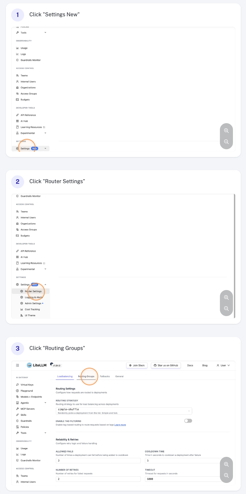
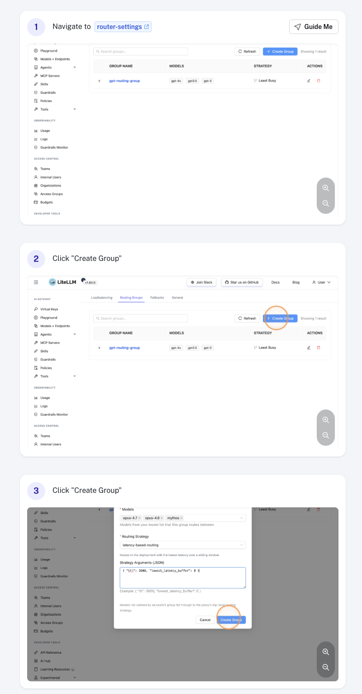
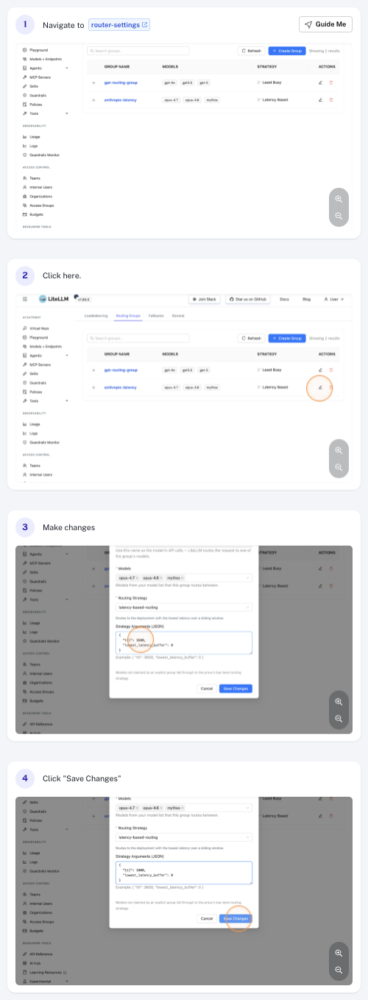
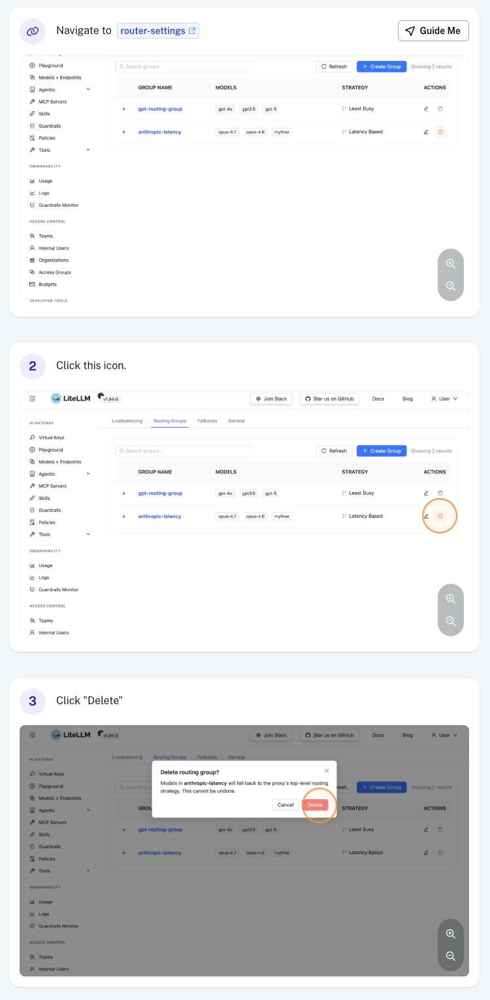
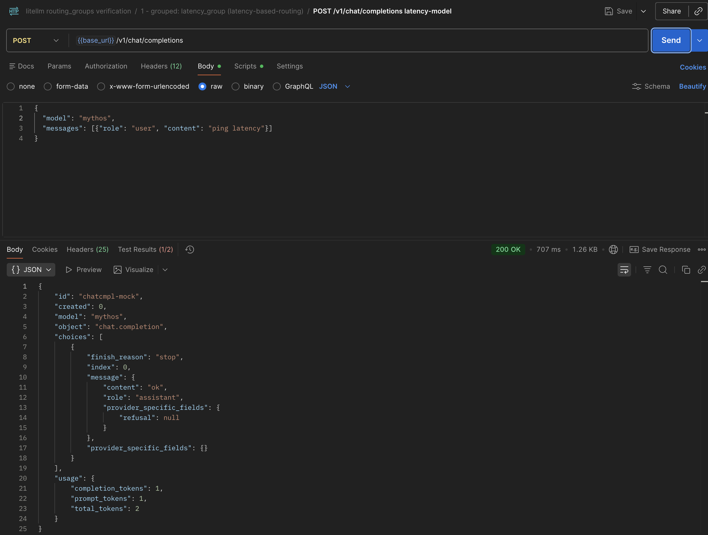
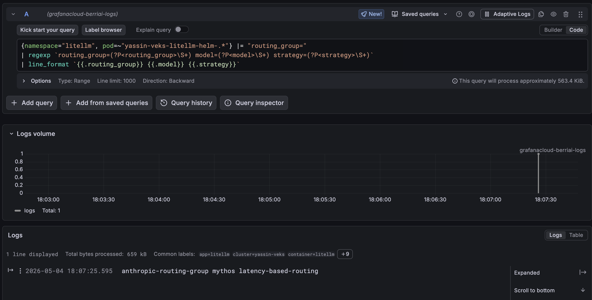

import Image from '@theme/IdealImage';

# 管理路由组

路由组（routing groups）让你可以在同一个路由器（Router）中为不同模型应用不同的路由策略，例如给 `{{openai_large}}` 使用基于延迟的路由（latency-based routing），而较便宜的模型使用 simple-shuffle。你可以在 LiteLLM 仪表板（dashboard）中直接管理路由组，无需修改 `proxy_config.yaml`。

概念概览与完整的策略参考见[路由组：按模型策略](../../routing.md#路由组---按模型策略与可调用的虚拟模型)。

> 点击下方任意截图，即可打开 Scribe 上的完整操作演示。

## 通过 UI 操作

### 路由组设置

在侧边栏进入**常规设置**（General Settings），选择**路由组**（Routing Groups）板块。

[](https://scribehow.com/viewer/Accessing_Routing_Groups_in_Settings__hxNoFOtLQeSfOvcLYgzXzA)

### 创建路由组

点击**添加路由组**（Add Routing Group），然后填写：

- **组名**（Group name）：唯一标识符，例如 `anthropic-latency`。`default` 是保留名称。
- **模型**（Models）：模型列表中的一个或多个 `model_name`，每个模型最多只能属于一个组。
- **路由策略**（Routing strategy）：应用到该组的策略，例如 `latency-based-routing`、`usage-based-routing-v2`、`simple-shuffle`。
- **路由策略参数**（Routing strategy args）*（可选）*：策略专属的覆盖配置，例如 `ttl`、`rpm`、`tpm`。

点击**保存**（Save）即可创建路由组。

[](https://scribehow.com/viewer/Create_a_New_Latency_Based_Routing_Group__y3EoV7U7QOaNdR1YrD-03w)

### 编辑路由组

点击表格中的组行将其打开，然后修改任意字段。例如，调整**路由策略参数**下的 `ttl`，控制策略对延迟变化的响应速度。改完点击**保存**生效。

[](https://scribehow.com/viewer/How_To_Configure_Strategy_Arguments_In_Router_Settings__u98H3SRAQKK-qHOa1Tbx9g)

### 删除路由组

点击组行上的**删除**（Delete）操作并确认。被删除组中的模型会立即回退（fallback）到默认路由策略。

[](https://scribehow.com/viewer/How_To_Delete_A_Router_Setting__O96ij__rQj6QjOurwOqSFA)

## 通过 `proxy_config.yaml` 配置

你也可以在代理配置文件中定义路由组。通过 UI 配置的设置会被持久化保存，并覆盖这里定义的值。

```yaml
router_settings:
  # fallback strategy for models not in any explicit group
  routing_strategy: simple-shuffle

  routing_groups:
    - group_name: anthropic-latency
      models: [claude-sonnet, claude-opus]
      routing_strategy: latency-based-routing
      routing_strategy_args:
        ttl: 3600
```

完整的 schema、多组示例以及运行时更新行为，参见[路由组：按模型策略](../../routing.md#路由组---按模型策略与可调用的虚拟模型)。

## 测试请求

配置好路由组后，需要确认发往组内模型的请求确实由该组的策略在路由。LiteLLM 会为每个请求记录所选的 `routing_group`、`model` 和 `strategy`，因此验证方式就是发一个请求，再检查代理日志。

### 1. 发送请求

直接调用组本身即可：组名就是一个可用的模型，会出现在 `/v1/models` 中，请求会按该组的策略路由到所有成员部署（deployment）：

```bash
curl -X POST 'http://localhost:4000/v1/chat/completions' \
  -H 'Authorization: Bearer <your-key>' \
  -H 'Content-Type: application/json' \
  -d '{
    "model": "anthropic-latency",
    "messages": [{"role": "user", "content": "ping"}]
  }'
```

或者向已被某个路由组认领的 `model_name` 发送请求：

```bash
curl -X POST 'http://localhost:4000/v1/chat/completions' \
  -H 'Authorization: Bearer <your-key>' \
  -H 'Content-Type: application/json' \
  -d '{
    "model": "claude-sonnet",
    "messages": [{"role": "user", "content": "ping"}]
  }'
```



### 2. 检查代理日志

每个请求都会输出一行日志，其中包含 `routing_group=<name> model=<model> strategy=<strategy>`。

**纯文本日志**。直接 grep 代理的标准输出：

```bash
kubectl logs -n litellm -l app=litellm --tail=200 | grep routing_group=
```

**Loki**（LogQL）。提取并重新格式化各字段，得到清晰的输出：

```logql
{namespace="litellm", pod=~"<your-litellm-pod-regex>"} |= "routing_group="
| regexp `routing_group=(?P<routing_group>\S+) model=(?P<model>\S+) strategy=(?P<strategy>\S+)`
| line_format `{{.routing_group}} {{.model}} {{.strategy}}`
```



如果看到类似 `anthropic-latency claude-sonnet latency-based-routing` 这样的行，说明请求命中了预期的组。如果显示的是 `default <strategy>`，说明该模型没有被任何组认领，请检查该组的**模型**列表。

## 注意事项

- 每个 `model_name` **最多只能属于一个**路由组，出现重叠会被拒绝。
- 组名 `default` 保留给隐式回退组。
- 更新会立即生效，因为保存时会重建每个组的状态。
