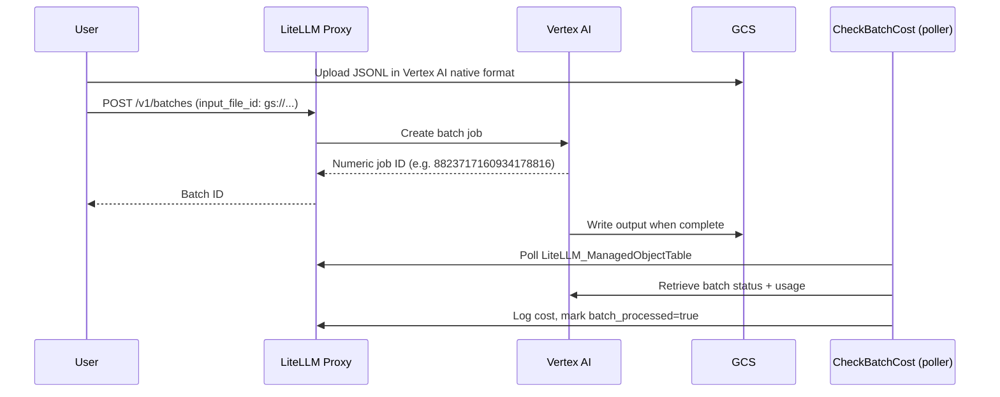

# 非托管 Vertex AI 批处理

<EnterpriseFeature />

对于 Vertex AI 批处理作业（batch job），LiteLLM 支持两条路径：托管路径会自动处理文件上传与格式转换；非托管路径允许你以 Vertex AI 原生格式把批处理文件直接上传到 GCS，LiteLLM 不做任何转换，但在启用相应开关后会追踪成本。

## 工作原理



## 配置

在代理配置中启用成本追踪（cost tracking）：

```yaml
general_settings:
  track_unmanaged_batch_cost: true  # Default: false
```

为你想要批处理的模型配置一个 `vertex_ai` 部署（deployment）。轮询器（poller）会使用该部署的凭证来轮询 Vertex 并计算成本：

```yaml
model_list:
  - model_name: {{gemini_flash}}
    litellm_params:
      model: vertex_ai/{{gemini_flash}}
      vertex_project: my-gcp-project
      vertex_location: us-central1
      vertex_credentials: /path/to/service-account.json
```

## GCS 路径要求

GCS 路径必须包含 `publishers/google/models/<model-name>/`，LiteLLM 才能从中解析出模型名以查找凭证。

```
gs://my-bucket/<any-prefix>/publishers/google/models/{{gemini_flash}}/<filename>.jsonl
```

存储桶名称以及 `publishers/` 之前的任意前缀都可以自由指定。

## 批处理文件格式

非托管批处理必须采用 Vertex AI 原生 JSONL 格式。托管路径接受 OpenAI 格式并自动完成转换；非托管路径完全跳过转换，因此你必须直接提供 Vertex AI 格式：

```json
{"custom_id": "1", "method": "POST", "url": "/v1/chat/completions", "body": {"model": "{{gemini_flash}}", "messages": [{"role": "user", "content": "What is 2+2?"}]}}
{"custom_id": "2", "method": "POST", "url": "/v1/chat/completions", "body": {"model": "{{gemini_flash}}", "messages": [{"role": "user", "content": "What is 3+3?"}]}}
```

## 使用方法

### 1. 上传到 GCS

```bash
gsutil cp batch.jsonl gs://my-bucket/batches/publishers/google/models/{{gemini_flash}}/batch.jsonl
```

### 2. 创建批处理

把 GCS URI 作为 `input_file_id` 传入：

```bash
curl -X POST http://localhost:4000/v1/batches \
  -H "Authorization: Bearer $LITELLM_API_KEY" \
  -H "Content-Type: application/json" \
  -d '{
    "input_file_id": "gs://my-bucket/batches/publishers/google/models/{{gemini_flash}}/batch.jsonl",
    "endpoint": "/v1/chat/completions",
    "completion_window": "24h",
    "custom_llm_provider": "vertex_ai"
  }'
```

响应中会包含原始的 Vertex 数字作业 ID（例如 `8823717160934178816`）。

### 3. 监控状态

传入 `custom_llm_provider=vertex_ai`，让代理路由到 Vertex 而不是 OpenAI：

```bash
curl -X GET "http://localhost:4000/v1/batches/8823717160934178816?custom_llm_provider=vertex_ai" \
  -H "Authorization: Bearer $LITELLM_API_KEY"
```

### 4. 获取结果

当 `status` 变为 `completed` 时，输出文件的位置会记录在 `output_file_id` 中。从 GCS 下载它：

```bash
gsutil cp gs://my-bucket/output/batch-results.jsonl .
```

每一行都是一个 Vertex AI 响应对象：

```json
{"custom_id": "1", "response": {"status_code": 200, "body": {"choices": [{"message": {"content": "2 + 2 = 4"}}]}}}
```

## 成本追踪

设置 `track_unmanaged_batch_cost: true` 后，CheckBatchCost 轮询器会自动完成成本追踪。它从 GCS 路径中提取模型名，使用已配置的 `vertex_ai` 部署轮询 Vertex 获取结果，计算 Token 成本，并把该批处理标记为已处理。成本会显示在代理日志界面的 `http://localhost:4000/ui/?page=logs`。

轮询间隔由 `general_settings` 中的 `proxy_batch_polling_interval` 控制（基准秒数；轮询器会额外加入 0-30 秒的抖动）。测试时可以设为 `10`，反馈更快。

轮询器写入花费日志的行与托管批处理得到的行结构相同，各字段的含义以及如何解读部分失败的批处理，请参阅[可观测性](/docs/proxy/managed_batches#可观测性)。

## 故障排查

**批处理没有被计费**。请检查是否设置了 `track_unmanaged_batch_cost: true`、GCS 路径中是否包含 `publishers/google/models/<model>/`，以及是否已配置 `vertex_ai` 部署。可以在日志中留意类似下面这样的行：

```
Skipping unmanaged vertex batch 8823717160934178816: no vertex_ai deployment configured for model {{gemini_flash}}
```

**成本为零**。Vertex AI 只有在批处理完全结束后，才会在响应体中包含 Token 用量。如果 status 已是 `completed` 但成本仍为零，请手动下载输出文件，确认其中包含带用量字段的响应数据。

## 托管 vs 非托管

| | 托管 | 非托管 |
|---|---|---|
| 输入格式 | OpenAI 对话补全 | Vertex AI 原生格式 |
| 文件上传 | 经由代理 | 直接上传到 GCS |
| 格式转换 | 自动 | 无 |
| 批处理 ID 格式 | Base64 编码的统一 ID | 原始 Vertex 数字 ID |
| 成本追踪 | 默认开启 | 需显式启用开关 |

托管批处理同样可以接受 Vertex 原生输入：在上传时设置 `passthrough=true`，LiteLLM 会逐字节存储文件并返回原生输出。详见[原生 Vertex JSONL 透传](/docs/providers/vertex_batch#vertex-原生-jsonl-透传)。

## 另请参阅

- [托管批处理](/docs/proxy/managed_batches)
- [Vertex AI 批量预测](https://cloud.google.com/vertex-ai/docs/batch-prediction/batch-prediction)
