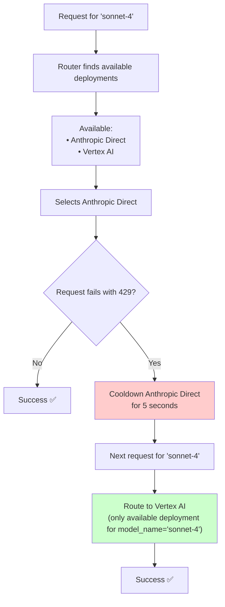

import Image from '@theme/IdealImage';
import Tabs from '@theme/Tabs';
import TabItem from '@theme/TabItem';


# Router - 负载均衡

LiteLLM 负责：
- 在多个部署（如 Azure/OpenAI）之间做负载均衡
- 优先保障重要请求不失败（即排队机制）
- 跨多个部署/提供商的基础可靠性逻辑：冷却、回退、超时与重试（固定 + 指数退避）。

生产环境中，litellm 支持用 Redis 在服务端追踪冷却与用量（管理 tpm/rpm 限制）。

:::info

如果你需要一个服务器在多个 LLM API 之间做负载均衡，请使用 [LiteLLM 代理服务器](./proxy/load_balancing.md)。

:::


## 负载均衡
（特别感谢 [@paulpierre](https://www.linkedin.com/in/paulpierre/) 与 [sweep proxy](https://docs.sweep.dev/blogs/openai-proxy) 对本实现的贡献）
[**查看代码**](https://github.com/BerriAI/litellm/blob/main/litellm/router.py)

### 快速上手

在多个 [azure](./providers/azure)/[bedrock](./providers/bedrock.md)/[提供商](./providers/) 部署之间做负载均衡。如果某次调用失败，LiteLLM 会在不同区域自动重试。

<Tabs>
<TabItem value="sdk" label="SDK">

```python
from litellm import Router

model_list = [{ # list of model deployments 
	"model_name": "{{openai_small}}", # model alias -> loadbalance between models with same `model_name`
	"litellm_params": { # params for litellm completion/embedding call 
		"model": "azure/chatgpt-v-2", # actual model name
		"api_key": os.getenv("AZURE_API_KEY"),
		"api_version": os.getenv("AZURE_API_VERSION"),
		"api_base": os.getenv("AZURE_API_BASE")
	}
}, {
    "model_name": "{{openai_small}}", 
	"litellm_params": { # params for litellm completion/embedding call 
		"model": "azure/chatgpt-functioncalling", 
		"api_key": os.getenv("AZURE_API_KEY"),
		"api_version": os.getenv("AZURE_API_VERSION"),
		"api_base": os.getenv("AZURE_API_BASE")
	}
}, {
    "model_name": "{{openai_small}}", 
	"litellm_params": { # params for litellm completion/embedding call 
		"model": "{{openai_small}}", 
		"api_key": os.getenv("OPENAI_API_KEY"),
	}
}, {
    "model_name": "{{openai_large}}", 
	"litellm_params": { # params for litellm completion/embedding call 
		"model": "azure/{{openai_large}}", 
		"api_key": os.getenv("AZURE_API_KEY"),
		"api_base": os.getenv("AZURE_API_BASE"),
		"api_version": os.getenv("AZURE_API_VERSION"),
	}
}, {
    "model_name": "{{openai_large}}", 
	"litellm_params": { # params for litellm completion/embedding call 
		"model": "{{openai_large}}", 
		"api_key": os.getenv("OPENAI_API_KEY"),
	}
},

]

router = Router(model_list=model_list)

# openai.ChatCompletion.create replacement
# requests with model="{{openai_small}}" will pick a deployment where model_name="{{openai_small}}"
response = await router.acompletion(model="{{openai_small}}", 
				messages=[{"role": "user", "content": "Hey, how's it going?"}])

print(response)

# openai.ChatCompletion.create replacement
# requests with model="{{openai_large}}" will pick a deployment where model_name="{{openai_large}}"
response = await router.acompletion(model="{{openai_large}}", 
				messages=[{"role": "user", "content": "Hey, how's it going?"}])

print(response)
```
</TabItem>
<TabItem value="proxy" label="PROXY">

:::info

详细的代理负载均衡/回退文档见[这里](./proxy/reliability.md)

:::

1. 配置包含多个部署的 model_list
```yaml
model_list:
  - model_name: {{openai_small}}
    litellm_params:
      model: azure/<your-deployment-name>
      api_base: <your-azure-endpoint>
      api_key: <your-azure-api-key>
  - model_name: {{openai_small}}
    litellm_params:
      model: azure/gpt-turbo-small-ca
      api_base: https://my-endpoint-canada-berri992.openai.azure.com/
      api_key: <your-azure-api-key>
  - model_name: {{openai_small}}
    litellm_params:
      model: azure/gpt-turbo-large
      api_base: https://openai-france-1234.openai.azure.com/
      api_key: <your-azure-api-key>
```

2. 启动代理

```bash
litellm --config /path/to/config.yaml
```

3. 测试一下！ 

```bash
curl -X POST 'http://0.0.0.0:4000/chat/completions' \
-H 'Content-Type: application/json' \
-H "Authorization: Bearer $LITELLM_API_KEY" \
-d '{
  "model": "{{openai_small}}",
  "messages": [
        {"role": "user", "content": "Hi there!"}
    ],
    "mock_testing_rate_limit_error": true
}'
```
</TabItem>
</Tabs>
### 可用端点
- `router.completion()` - 调用 100 多种 LLM 的对话补全端点
- `router.acompletion()` - 异步对话补全调用
- `router.embedding()` - 面向 Azure、OpenAI、Huggingface 端点的嵌入端点
- `router.aembedding()` - 异步嵌入调用
- `router.text_completion()` - 旧版 OpenAI `/v1/completions` 端点格式的补全调用
- `router.atext_completion()` - 异步文本补全调用
- `router.image_generation()` - OpenAI `/v1/images/generations` 端点格式的图像生成调用
- `router.aimage_generation()` - 异步图像生成调用

## 进阶 - 路由策略 ⭐️
#### 路由策略 - 加权随机、速率限制感知、最少占用、基于延迟、基于成本

Router 提供多种策略，把你的调用分发到多个部署。**我们推荐在生产环境使用 `simple-shuffle`（默认）以获得最佳性能**。

<Tabs>
<TabItem value="simple-shuffle" label="（默认）加权随机 - 推荐">

**默认，推荐用于生产环境**：性能最佳，额外延迟开销最小。

根据提供的**每分钟请求数**（rpm）或**每分钟 Token 数**（tpm）来挑选部署。

如果未提供 `rpm` 或 `tpm`，则随机挑选一个部署。

你也可以设置 `weight` 参数，指定什么情况下优先选哪个模型。

<Tabs>
<TabItem value="rpm" label="基于 RPM 的随机挑选">

##### **LiteLLM Proxy Config.yaml**

```yaml
model_list:
    - model_name: {{openai_small}}
      litellm_params:
        model: azure/chatgpt-v-2
        api_key: os.environ/AZURE_API_KEY
        api_version: os.environ/AZURE_API_VERSION
        api_base: os.environ/AZURE_API_BASE
        rpm: 900 
    - model_name: {{openai_small}}
      litellm_params:
        model: azure/chatgpt-functioncalling
        api_key: os.environ/AZURE_API_KEY
        api_version: os.environ/AZURE_API_VERSION
        api_base: os.environ/AZURE_API_BASE
        rpm: 10 
```

##### **Python SDK**

```python
from litellm import Router 
import asyncio

model_list = [{ # list of model deployments 
	"model_name": "{{openai_small}}", # model alias 
	"litellm_params": { # params for litellm completion/embedding call 
		"model": "azure/chatgpt-v-2", # actual model name
		"api_key": os.getenv("AZURE_API_KEY"),
		"api_version": os.getenv("AZURE_API_VERSION"),
		"api_base": os.getenv("AZURE_API_BASE"),
		"rpm": 900,			# requests per minute for this API
	}
}, {
    "model_name": "{{openai_small}}", 
	"litellm_params": { # params for litellm completion/embedding call 
		"model": "azure/chatgpt-functioncalling", 
		"api_key": os.getenv("AZURE_API_KEY"),
		"api_version": os.getenv("AZURE_API_VERSION"),
		"api_base": os.getenv("AZURE_API_BASE"),
		"rpm": 10,
	}
},]

# init router
router = Router(model_list=model_list, routing_strategy="simple-shuffle")
async def router_acompletion():
	response = await router.acompletion(
		model="{{openai_small}}", 
		messages=[{"role": "user", "content": "Hey, how's it going?"}]
	)
	print(response)
	return response

asyncio.run(router_acompletion())
```

</TabItem>
<TabItem value="weight" label="基于权重的随机挑选">

##### **LiteLLM Proxy Config.yaml**

```yaml
model_list:
    - model_name: {{openai_small}}
      litellm_params:
        model: azure/chatgpt-v-2
        api_key: os.environ/AZURE_API_KEY
        api_version: os.environ/AZURE_API_VERSION
        api_base: os.environ/AZURE_API_BASE
        weight: 9
    - model_name: {{openai_small}}
      litellm_params:
        model: azure/chatgpt-functioncalling
        api_key: os.environ/AZURE_API_KEY
        api_version: os.environ/AZURE_API_VERSION
        api_base: os.environ/AZURE_API_BASE
        weight: 1 
```

##### **Python SDK**

```python
from litellm import Router 
import asyncio

model_list = [{
	"model_name": "{{openai_small}}", # model alias 
	"litellm_params": { 
		"model": "azure/chatgpt-v-2", # actual model name
		"api_key": os.getenv("AZURE_API_KEY"),
		"api_version": os.getenv("AZURE_API_VERSION"),
		"api_base": os.getenv("AZURE_API_BASE"),
		"weight": 9, # pick this 90% of the time
	}
}, {
    "model_name": "{{openai_small}}", 
	"litellm_params": { 
		"model": "azure/chatgpt-functioncalling", 
		"api_key": os.getenv("AZURE_API_KEY"),
		"api_version": os.getenv("AZURE_API_VERSION"),
		"api_base": os.getenv("AZURE_API_BASE"),
		"weight": 1,
	}
}]

# init router
router = Router(model_list=model_list, routing_strategy="simple-shuffle")
async def router_acompletion():
	response = await router.acompletion(
		model="{{openai_small}}", 
		messages=[{"role": "user", "content": "Hey, how's it going?"}]
	)
	print(response)
	return response

asyncio.run(router_acompletion())
```

</TabItem>
</Tabs>

</TabItem>
<TabItem value="usage-based-v2" label="速率限制感知 v2（异步）">

:::warning

**基于用量的路由**（usage-based routing）因性能损耗不建议用于生产环境。高流量场景请使用 `simple-shuffle`（默认）以获得最佳性能。基于用量的路由需要通过 Redis 操作追踪各部署的用量，会带来显著延迟。

:::


**🎉 NEW** 这是基于用量的路由的异步实现。

**如果传入部署的 tpm/rpm 上限，超出上限的部署会被过滤掉**。

会路由到该分钟内 **TPM 用量最低**的部署。

生产环境中，我们用 Redis 追踪多个部署的用量（TPM/RPM）。该实现使用**异步 Redis 调用**（redis.incr 和 redis.mget）。

对 Azure 而言，[每 1000 TPM 可获得 6 RPM](https://stackoverflow.com/questions/77368844/what-is-the-request-per-minute-rate-limit-for-azure-openai-models-for-gpt-3-5-tu)

<Tabs>
<TabItem value="sdk" label="sdk">

```python
from litellm import Router 


model_list = [{ # list of model deployments 
	"model_name": "{{openai_small}}", # model alias 
	"litellm_params": { # params for litellm completion/embedding call 
		"model": "azure/chatgpt-v-2", # actual model name
		"api_key": os.getenv("AZURE_API_KEY"),
		"api_version": os.getenv("AZURE_API_VERSION"),
		"api_base": os.getenv("AZURE_API_BASE"),
		"tpm": 100000,
		"rpm": 10000,
	}, 
}, {
    "model_name": "{{openai_small}}", 
	"litellm_params": { # params for litellm completion/embedding call 
		"model": "azure/chatgpt-functioncalling", 
		"api_key": os.getenv("AZURE_API_KEY"),
		"api_version": os.getenv("AZURE_API_VERSION"),
		"api_base": os.getenv("AZURE_API_BASE"),
		"tpm": 100000,
		"rpm": 1000,
	},
}, {
    "model_name": "{{openai_small}}", 
	"litellm_params": { # params for litellm completion/embedding call 
		"model": "{{openai_small}}", 
		"api_key": os.getenv("OPENAI_API_KEY"),
		"tpm": 100000,
		"rpm": 1000,
	},
}]
router = Router(model_list=model_list, 
                redis_host=os.environ["REDIS_HOST"], 
				redis_password=os.environ["REDIS_PASSWORD"], 
				redis_port=os.environ["REDIS_PORT"], 
                routing_strategy="simple-shuffle", # 👈 RECOMMENDED - best performance
				enable_pre_call_checks=True, # enables router rate limits for concurrent calls
				)

response = await router.acompletion(model="{{openai_small}}", 
				messages=[{"role": "user", "content": "Hey, how's it going?"}])

print(response)
```
</TabItem>
<TabItem value="proxy" label="proxy">

**1. 在配置中设置策略**

```yaml
model_list:
    - model_name: {{openai_small}} # model alias 
      litellm_params: # params for litellm completion/embedding call 
        model: azure/chatgpt-v-2 # actual model name
        api_key: os.environ/AZURE_API_KEY
        api_version: os.environ/AZURE_API_VERSION
        api_base: os.environ/AZURE_API_BASE
      tpm: 100000
      rpm: 10000
    - model_name: {{openai_small}} 
      litellm_params: # params for litellm completion/embedding call 
        model: {{openai_small}} 
        api_key: os.environ/OPENAI_API_KEY
      tpm: 100000
      rpm: 1000

router_settings:
  routing_strategy: simple-shuffle # 👈 RECOMMENDED - best performance
  redis_host: <your-redis-host>
  redis_password: <your-redis-password>
  redis_port: <your-redis-port>
  enable_pre_call_checks: true

general_settings:
  master_key: os.environ/LITELLM_MASTER_KEY
```

**2. 启动代理**

```bash
litellm --config /path/to/config.yaml
```

**3. 测试一下**！

```bash
curl --location 'http://localhost:4000/v1/chat/completions' \
--header 'Content-Type: application/json' \
--header "Authorization: Bearer $LITELLM_API_KEY" \
--data '{
    "model": "{{openai_small}}", 
    "messages": [{"role": "user", "content": "Hey, how's it going?"}]
}'
```

</TabItem>
</Tabs>


</TabItem>
<TabItem value="latency-based" label="基于延迟">


选择响应时间最低的部署。

它会缓存并根据请求发出与响应返回的时间，持续更新各部署的响应时间。

[**如何测试**](https://github.com/BerriAI/litellm/blob/main/tests/local_testing/test_lowest_latency_routing.py)

```python
from litellm import Router 
import asyncio

model_list = [{ ... }]

# init router
router = Router(model_list=model_list,
				routing_strategy="latency-based-routing",# 👈 set routing strategy
				enable_pre_call_checks=True, # enables router rate limits for concurrent calls
				)

## CALL 1+2
tasks = []
response = None
final_response = None
for _ in range(2):
	tasks.append(router.acompletion(model=model, messages=messages))
response = await asyncio.gather(*tasks)

if response is not None:
	## CALL 3 
	await asyncio.sleep(1)  # let the cache update happen
	picked_deployment = router.lowestlatency_logger.get_available_deployments(
		model_group=model, healthy_deployments=router.healthy_deployments
	)
	final_response = await router.acompletion(model=model, messages=messages)
	print(f"min deployment id: {picked_deployment}")
	print(f"model id: {final_response._hidden_params['model_id']}")
	assert (
		final_response._hidden_params["model_id"]
		== picked_deployment["model_info"]["id"]
	)
```

#### 设置时间窗口 

设置一个时间窗口，决定计算部署平均延迟时向前回溯多久。

**在 Router 中**
```python 
router = Router(..., routing_strategy_args={"ttl": 10})
```

**在 Proxy 中**

```yaml
router_settings:
  routing_strategy_args: {"ttl": 10}
```

#### 设置最低延迟缓冲区

设置一个缓冲区间，只有处于该区间内的部署才有资格承接调用。

例如： 

如果你有 5 个部署

```
https://litellm-prod-1.openai.azure.com/: 0.07s
https://litellm-prod-2.openai.azure.com/: 0.1s
https://litellm-prod-3.openai.azure.com/: 0.1s
https://litellm-prod-4.openai.azure.com/: 0.1s
https://litellm-prod-5.openai.azure.com/: 4.66s
```

为避免一开始把所有请求都压到 `prod-1` 上，可以设置 50% 的缓冲区，只把 `prod-2, prod-3, prod-4` 纳入候选。

**在 Router 中**
```python 
router = Router(..., routing_strategy_args={"lowest_latency_buffer": 0.5})
```

**在 Proxy 中**

```yaml
router_settings:
  routing_strategy_args: {"lowest_latency_buffer": 0.5}
```

</TabItem>

<TabItem value="usage-based" label="速率限制感知">

会路由到该分钟内 TPM 用量最低的部署。

生产环境中，我们用 Redis 追踪多个部署的用量（TPM/RPM）。

如果传入部署的 tpm/rpm 上限，还会据此检查并过滤掉会超限的部署。

对 Azure 而言，你的 RPM = TPM/6。


```python
from litellm import Router 


model_list = [{ # list of model deployments 
	"model_name": "{{openai_small}}", # model alias 
	"litellm_params": { # params for litellm completion/embedding call 
		"model": "azure/chatgpt-v-2", # actual model name
		"api_key": os.getenv("AZURE_API_KEY"),
		"api_version": os.getenv("AZURE_API_VERSION"),
		"api_base": os.getenv("AZURE_API_BASE")
	}, 
    "tpm": 100000,
	"rpm": 10000,
}, {
    "model_name": "{{openai_small}}", 
	"litellm_params": { # params for litellm completion/embedding call 
		"model": "azure/chatgpt-functioncalling", 
		"api_key": os.getenv("AZURE_API_KEY"),
		"api_version": os.getenv("AZURE_API_VERSION"),
		"api_base": os.getenv("AZURE_API_BASE")
	},
    "tpm": 100000,
	"rpm": 1000,
}, {
    "model_name": "{{openai_small}}", 
	"litellm_params": { # params for litellm completion/embedding call 
		"model": "{{openai_small}}", 
		"api_key": os.getenv("OPENAI_API_KEY"),
	},
    "tpm": 100000,
	"rpm": 1000,
}]
router = Router(model_list=model_list, 
                redis_host=os.environ["REDIS_HOST"], 
				redis_password=os.environ["REDIS_PASSWORD"], 
				redis_port=os.environ["REDIS_PORT"], 
                routing_strategy="usage-based-routing",
				enable_pre_call_checks=True, # enables router rate limits for concurrent calls
				)

response = await router.acompletion(model="{{openai_small}}", 
				messages=[{"role": "user", "content": "Hey, how's it going?"}])

print(response)
```


</TabItem>
<TabItem value="least-busy" label="最少占用">


选择正在处理的调用数最少的部署。

[**如何测试**](https://github.com/BerriAI/litellm/blob/main/tests/local_testing/test_least_busy_routing.py)

```python
from litellm import Router 
import asyncio

model_list = [{ # list of model deployments 
	"model_name": "{{openai_small}}", # model alias 
	"litellm_params": { # params for litellm completion/embedding call 
		"model": "azure/chatgpt-v-2", # actual model name
		"api_key": os.getenv("AZURE_API_KEY"),
		"api_version": os.getenv("AZURE_API_VERSION"),
		"api_base": os.getenv("AZURE_API_BASE"),
	}
}, {
    "model_name": "{{openai_small}}", 
	"litellm_params": { # params for litellm completion/embedding call 
		"model": "azure/chatgpt-functioncalling", 
		"api_key": os.getenv("AZURE_API_KEY"),
		"api_version": os.getenv("AZURE_API_VERSION"),
		"api_base": os.getenv("AZURE_API_BASE"),
	}
}, {
    "model_name": "{{openai_small}}", 
	"litellm_params": { # params for litellm completion/embedding call 
		"model": "{{openai_small}}", 
		"api_key": os.getenv("OPENAI_API_KEY"),
	}
}]

# init router
router = Router(model_list=model_list, routing_strategy="least-busy")
async def router_acompletion():
	response = await router.acompletion(
		model="{{openai_small}}", 
		messages=[{"role": "user", "content": "Hey, how's it going?"}]
	)
	print(response)
	return response

asyncio.run(router_acompletion())
```

</TabItem>
<TabItem value="custom" label="自定义路由策略">

**以插件形式接入自定义路由策略来挑选部署**


第 1 步：定义你的自定义路由策略

```python

from litellm.router import CustomRoutingStrategyBase
class CustomRoutingStrategy(CustomRoutingStrategyBase):
    async def async_get_available_deployment(
        self,
        model: str,
        messages: Optional[List[Dict[str, str]]] = None,
        input: Optional[Union[str, List]] = None,
        specific_deployment: Optional[bool] = False,
        request_kwargs: Optional[Dict] = None,
    ):
        """
        Asynchronously retrieves the available deployment based on the given parameters.

        Args:
            model (str): The name of the model.
            messages (Optional[List[Dict[str, str]]], optional): The list of messages for a given request. Defaults to None.
            input (Optional[Union[str, List]], optional): The input for a given embedding request. Defaults to None.
            specific_deployment (Optional[bool], optional): Whether to retrieve a specific deployment. Defaults to False.
            request_kwargs (Optional[Dict], optional): Additional request keyword arguments. Defaults to None.

        Returns:
            Returns an element from litellm.router.model_list

        """
        print("In CUSTOM async get available deployment")
        model_list = router.model_list
        print("router model list=", model_list)
        for model in model_list:
            if isinstance(model, dict):
                if model["litellm_params"]["model"] == "openai/very-special-endpoint":
                    return model
        pass

    def get_available_deployment(
        self,
        model: str,
        messages: Optional[List[Dict[str, str]]] = None,
        input: Optional[Union[str, List]] = None,
        specific_deployment: Optional[bool] = False,
        request_kwargs: Optional[Dict] = None,
    ):
        """
        Synchronously retrieves the available deployment based on the given parameters.

        Args:
            model (str): The name of the model.
            messages (Optional[List[Dict[str, str]]], optional): The list of messages for a given request. Defaults to None.
            input (Optional[Union[str, List]], optional): The input for a given embedding request. Defaults to None.
            specific_deployment (Optional[bool], optional): Whether to retrieve a specific deployment. Defaults to False.
            request_kwargs (Optional[Dict], optional): Additional request keyword arguments. Defaults to None.

        Returns:
            Returns an element from litellm.router.model_list

        """
        pass
```

第 2 步：用自定义路由策略初始化 Router
```python
from litellm import Router

router = Router(
    model_list=[
        {
            "model_name": "azure-model",
            "litellm_params": {
                "model": "openai/very-special-endpoint",
                "api_base": "https://exampleopenaiendpoint-production.up.railway.app/",  # If you are Krrish, this is OpenAI Endpoint3 on our Railway endpoint :)
                "api_key": "fake-key",
            },
            "model_info": {"id": "very-special-endpoint"},
        },
        {
            "model_name": "azure-model",
            "litellm_params": {
                "model": "openai/fast-endpoint",
                "api_base": "https://exampleopenaiendpoint-production.up.railway.app/",
                "api_key": "fake-key",
            },
            "model_info": {"id": "fast-endpoint"},
        },
    ],
    set_verbose=True,
    debug_level="DEBUG",
    timeout=1,
)  # type: ignore

router.set_custom_routing_strategy(CustomRoutingStrategy()) # 👈 Set your routing strategy here
```

第 3 步：测试你的路由策略。运行 `router.acompletion` 请求时，你的自定义路由策略应当会被调用。
```python
for _ in range(10):
	response = await router.acompletion(
		model="azure-model", messages=[{"role": "user", "content": "hello"}]
	)
	print(response)
	_picked_model_id = response._hidden_params["model_id"]
	print("picked model=", _picked_model_id)
```


</TabItem>

<TabItem value="lowest-cost" label="最低成本路由（异步）">

选择成本最低的部署。

工作原理：
- 获取所有健康的部署
- 筛出仍在给定 `rpm/tpm` 上限内的部署
- 对每个部署检查 `litellm_param["model"]` 是否存在于 [`litellm_model_cost_map`](https://github.com/BerriAI/litellm/blob/main/model_prices_and_context_window.json) 
	- 如果部署不在 `litellm_model_cost_map` 中 -> 使用 deployment_cost= `$1`
- 选择成本最低的部署

```python
from litellm import Router 
import asyncio

model_list =  [
	{
		"model_name": "{{openai_small}}",
		"litellm_params": {"model": "{{openai_large}}"},
		"model_info": {"id": "openai-gpt-4o"},
	},
	{
		"model_name": "{{openai_small}}",
		"litellm_params": {"model": "groq/llama3-8b-8192"},
		"model_info": {"id": "groq-llama"},
	},
]

# init router
router = Router(model_list=model_list, routing_strategy="cost-based-routing")
async def router_acompletion():
	response = await router.acompletion(
		model="{{openai_small}}", 
		messages=[{"role": "user", "content": "Hey, how's it going?"}]
	)
	print(response)

	print(response._hidden_params["model_id"]) # expect groq-llama, since groq/llama has lowest cost
	return response

asyncio.run(router_acompletion())

```


#### 使用自定义输入/输出定价

设置 `litellm_params["input_cost_per_token"]` 与 `litellm_params["output_cost_per_token"]`，即可在路由时使用自定义定价

```python
model_list = [
	{
		"model_name": "{{openai_small}}",
		"litellm_params": {
			"model": "azure/chatgpt-v-2",
			"input_cost_per_token": 0.00003,
			"output_cost_per_token": 0.00003,
		},
		"model_info": {"id": "chatgpt-v-experimental"},
	},
	{
		"model_name": "{{openai_small}}",
		"litellm_params": {
			"model": "azure/chatgpt-v-1",
			"input_cost_per_token": 0.000000001,
			"output_cost_per_token": 0.00000001,
		},
		"model_info": {"id": "chatgpt-v-1"},
	},
	{
		"model_name": "{{openai_small}}",
		"litellm_params": {
			"model": "azure/chatgpt-v-5",
			"input_cost_per_token": 10,
			"output_cost_per_token": 12,
		},
		"model_info": {"id": "chatgpt-v-5"},
	},
]
# init router
router = Router(model_list=model_list, routing_strategy="cost-based-routing")
async def router_acompletion():
	response = await router.acompletion(
		model="{{openai_small}}", 
		messages=[{"role": "user", "content": "Hey, how's it going?"}]
	)
	print(response)

	print(response._hidden_params["model_id"]) # expect chatgpt-v-1, since chatgpt-v-1 has lowest cost
	return response

asyncio.run(router_acompletion())
```

</TabItem>
</Tabs>
## 路由组 - 按模型策略与可调用的虚拟模型

在同一个 Router 里对不同模型应用不同的路由策略。一个**路由组**（routing group）把一组 `model_name` 绑定到某个策略以及（可选的）策略参数。未被任何组认领的模型会退回 Router 顶层的 `routing_strategy`。

组本身也可以**当作模型来调用**：请求 `model: <group_name>`，LiteLLM 会用该组的策略在所有成员部署的并集中挑选。组名会出现在 `/v1/models` 中，因此从网关发现模型的客户端（配置了 `CLAUDE_CODE_ENABLE_GATEWAY_MODEL_DISCOVERY=1` 的 Claude Code、Codex）会在自己的模型选择器里展示这些组。

```bash
curl http://localhost:4000/v1/chat/completions \
  -H "Authorization: Bearer $LITELLM_KEY" \
  -d '{"model": "anthropic-latency", "messages": [{"role": "user", "content": "ping"}]}'
```

访问控制把组视为一个独立的模型名：在密钥或团队上授予 `<group_name>`，即可列出并调用该组。成员关系不会在两个方向上展开，所以只被授予组的密钥不能直接调用成员，而被授予成员的密钥也不能调用组。组名不得与已有的 `model_name` 或 `model_group_alias` 冲突；冲突时配置加载会直接拒绝。请求在花费日志里以组名作为 `model_group`，每行记录实际服务的成员部署。回退和 `model_group_retry_policy` 按名称索引，需要的话请为组单独配置条目。Claude Code 与 Claude Desktop 只会自动发现名称包含 `claude` 或 `anthropic` 的网关模型，如果想让组出现在选择器里又不想手动设置 `ANTHROPIC_CUSTOM_MODEL_OPTION`，可以把组命名为 `claude-quality` 这类。

:::tip
你还可以在仪表板中创建、编辑和删除路由组。参见[通过 UI 管理路由组](./proxy/ui/routing_groups.md)。
:::

**适用场景**：你想让 `{{openai_large}}` 走基于延迟的路由，而更便宜的模型用普通的加权随机，同时又不想另起一个 Router。

#### 规则

- 每个 `model_name` 最多属于**一个**组。重叠会在初始化时抛出 `ValueError`。
- 不在任何组里的模型使用顶层的 `routing_strategy` / `routing_strategy_args`（相当于一个隐式的 `"default"` 组）。`"default"` 这个名字是保留的。
- 每个组都可以覆盖 `routing_strategy_args`（如延迟窗口 TTL、TPM 上限）。
- 组在每次请求时解析，依据是 pre-routing hook 处理之后的 `model` 名称。

<Tabs>
<TabItem value="config-yaml" label="LiteLLM Proxy Config.yaml">

```yaml
model_list:
  - model_name: {{openai_large}}
    litellm_params:
      model: openai/{{openai_large}}
      api_key: os.environ/OPENAI_API_KEY
  - model_name: {{openai_large}}
    litellm_params:
      model: azure/{{openai_large}}
      api_base: os.environ/AZURE_API_BASE
      api_key: os.environ/AZURE_API_KEY
      api_version: "2024-08-01-preview"
  - model_name: cheap-model
    litellm_params:
      model: openai/{{openai_small}}
      api_key: os.environ/OPENAI_API_KEY

router_settings:
  # fallback strategy for models not in any explicit group
  routing_strategy: simple-shuffle

  routing_groups:
    - group_name: latency-sensitive
      models: [{{openai_large}}]
      routing_strategy: latency-based-routing
      routing_strategy_args:
        ttl: 3600
```

行为：
- `{{openai_large}}` → 在 OpenAI + Azure 的部署间走基于延迟的路由。
- `cheap-model` → simple-shuffle（默认组）。

</TabItem>
<TabItem value="sdk" label="Python SDK">

```python
from litellm import Router

router = Router(
    model_list=[
        {"model_name": "{{openai_large}}", "litellm_params": {"model": "openai/{{openai_large}}"}},
        {"model_name": "{{openai_large}}", "litellm_params": {"model": "azure/{{openai_large}}", "api_base": "...", "api_key": "..."}},
        {"model_name": "cheap-model", "litellm_params": {"model": "openai/{{openai_small}}"}},
    ],
    routing_strategy="simple-shuffle",  # fallback for ungrouped models
    routing_groups=[
        {
            "group_name": "latency-sensitive",
            "models": ["{{openai_large}}"],
            "routing_strategy": "latency-based-routing",
            "routing_strategy_args": {"ttl": 3600},
        },
    ],
)
```

</TabItem>
</Tabs>


#### 多组

两个组可以使用同一个策略，但传入不同参数；每个组各自持有独立的状态实例。

```yaml
router_settings:
  routing_strategy: simple-shuffle
  routing_groups:
    - group_name: hot-path
      models: [{{openai_large}}, claude-sonnet]
      routing_strategy: latency-based-routing
      routing_strategy_args:
        ttl: 60          # short window — react quickly to latency changes
    - group_name: batch
      models: [{{openai_small}}, llama-70b]
      routing_strategy: usage-based-routing-v2
      routing_strategy_args:
        rpm: 10000
```

#### 运行时更新

路由组（routing group）可以通过 `Router.update_settings(routing_groups=[...])` 或代理的 `/config/update` 端点更新。更新时会重建每个组的状态。

## 会话亲和（粘性会话）

把一段对话中的每个请求都固定到服务过其首个请求的那个部署上。会话亲和（session affinity）是一种路由器调用前检查（pre-call check）：它在路由策略挑选部署之前运行，把候选范围缩小到被固定的那一个，因此与本页的每一种策略（`simple-shuffle`、`least-busy`、`usage-based-routing-v2`、`latency-based-routing`、`cost-based-routing`）以及路由组都能搭配使用。

当模型组背后的部署彼此不共享状态（例如提供商侧的提示词缓存），或者一段对话必须留在同一区域时，可以使用它。

<Tabs>
<TabItem value="proxy" label="Proxy">

```yaml showLineNumbers title="config.yaml"
model_list:
  - model_name: {{openai_large}}
    litellm_params:
      model: azure/{{openai_large}}
      api_key: os.environ/AZURE_API_KEY_EASTUS
      api_base: https://eastus.openai.azure.com
  - model_name: {{openai_large}}
    litellm_params:
      model: azure/{{openai_large}}
      api_key: os.environ/AZURE_API_KEY_WESTUS
      api_base: https://westus.openai.azure.com

router_settings:
  routing_strategy: simple-shuffle          # any strategy
  optional_pre_call_checks: ["session_affinity"]
  deployment_affinity_ttl_seconds: 3600     # optional, default 3600
```

对话的每个请求都带上会话 id。代理会从 `x-litellm-session-id` 请求头（`x-litellm-trace-id` 同样可用）、任意 `x-<vendor>-session-id` 请求头（如 `x-claude-code-session-id`）或请求体中的 `metadata.session_id` 读取它。

```bash
curl http://0.0.0.0:4000/v1/chat/completions \
  -H "Authorization: Bearer $LITELLM_API_KEY" \
  -H "Content-Type: application/json" \
  -H "x-litellm-session-id: 7f1c2d1e-2b5a-4a5e-9c1f-0d5a9a3f8b21" \
  -d '{"model": "{{openai_large}}", "messages": [{"role": "user", "content": "hi"}]}'
```

`x-litellm-model-id` 响应头会显示是哪个部署服务了该请求。只要会话 id 相同，这个值在所有请求上都保持一致。

</TabItem>
<TabItem value="sdk" label="SDK">

```python showLineNumbers
from litellm import Router

router = Router(
    model_list=[
        {
            "model_name": "{{openai_large}}",
            "litellm_params": {"model": "azure/{{openai_large}}", "api_key": "...", "api_base": "https://eastus.openai.azure.com"},
        },
        {
            "model_name": "{{openai_large}}",
            "litellm_params": {"model": "azure/{{openai_large}}", "api_key": "...", "api_base": "https://westus.openai.azure.com"},
        },
    ],
    routing_strategy="simple-shuffle",                 # any strategy
    optional_pre_call_checks=["session_affinity"],
    deployment_affinity_ttl_seconds=3600,              # optional, default 3600
)

response = await router.acompletion(
    model="{{openai_large}}",
    messages=[{"role": "user", "content": "hi"}],
    metadata={"session_id": "7f1c2d1e-2b5a-4a5e-9c1f-0d5a9a3f8b21"},
)
print(response._hidden_params["model_id"])  # same deployment for every call with this session_id
```

</TabItem>
</Tabs>

#### 工作原理

- 带有新会话 id 的首个请求照常由策略路由，它落到的部署就成为该模型组与该会话 id 的固定目标（在代理上，固定对象还会按调用方进一步限定：虚拟密钥（virtual key），或 JWT 认证下的已认证用户 id）。
- 之后所有带相同会话 id 的请求，都会在策略运行前被缩小到固定的部署上。
- 每个请求都会刷新固定记录，因此 `deployment_affinity_ttl_seconds` 限制的是对话轮次之间的空闲时间，而不是对话的总长度。
- 固定记录存放在路由器缓存中。配置了 Redis 时，它们在多个代理实例之间共享；没有 Redis 时，每个实例各自维护一份。
- 如果被固定的部署正处于冷却中，或已不在该模型组里，请求会回退到路由策略，在其余健康部署中选择。固定记录会保留，因此该部署恢复健康后，会话会回到它上面。v1.97.0 之前的版本则会把会话重新固定到策略选中的部署。
- 负载均衡发生在会话之间而不是请求之间：只要会话还活跃，它就一直使用同一个部署。

#### 配置项

| 配置项 | 说明 |
|---|---|
| `optional_pre_call_checks` | 加入 `session_affinity` 以按会话 id 固定。加入 `deployment_affinity` 可以改为按调用方固定，也可以与会话 id 同时使用（会话固定优先）。在代理上，调用方指虚拟密钥；请求不带密钥时则为已认证用户 id（JWT 认证）。`responses_api_deployment_check` 与 `encrypted_content_affinity` 见 [Responses API 会话连续性](./response_api.md#会话连续性负载均衡)。 |
| `deployment_affinity_ttl_seconds` | 固定记录的空闲 TTL，单位为秒。默认 `3600`。 |
| `model_group_affinity_config` | 只为部分模型组启用亲和，例如 `{"gpt-4.1": ["session_affinity"]}`。未列出的组使用全局的 `optional_pre_call_checks`。 |

`deployment_affinity_ttl_seconds` 与 `model_group_affinity_config` 在启动时读取：在 `config.yaml`（或 `Router()` 上）设置它们，然后重启代理。`optional_pre_call_checks` 也可以在运行中的代理上通过 `POST /config/update` 修改，请求体为 `{"router_settings": {"optional_pre_call_checks": [...]}}`，前提是该键没有在 `config.yaml` 中设置（配置文件中的值优先，发送不同的值会返回 400）。这次调用需要管理员密钥、一个数据库以及 `STORE_MODEL_IN_DB=True`。新列表会替换旧列表并存入数据库，因此每个轮询数据库的实例都会应用它。新列表中的名称立即开启；被省略的名称中，`prompt_caching`、`enforce_model_rate_limits` 与 `encrypted_content_affinity`（最后一项自 v1.104.0 起）会立即关闭，而 `session_affinity`、`deployment_affinity`、`responses_api_deployment_check` 与 `router_budget_limiting` 会保持开启直到重启。`GET /router/settings` 显示已存储的列表，即配置文件与数据库合并后的结果。

:::info
[自动路由](./proxy/auto_routing.md)页面上 `complexity_router_config` 中的 `session_affinity` 选项是另一个设置。它固定的是自动路由器在一段会话内选择的模型；本页的调用前检查固定的则是模型组内的一个部署。
:::

## 流量镜像 / 静默实验

流量镜像（traffic mirroring）允许你把生产流量"模仿"一份发送到辅助（静默）模型上做评估。静默模型的响应在后台收集，不影响主请求的延迟或结果。

[**A/B 测试与流量镜像的详细指南见此**](./traffic_mirroring.md)

## 基础可靠性

### 部署顺序（优先级）

在 `litellm_params` 中设置 `order` 来为部署排定优先级。数值越小，优先级越高。当多个部署具有相同的 `order` 时，由路由策略在它们之间挑选。

发往 `order=1` 部署的请求失败时（连接错误、404、429 等），路由器会自动尝试 `order=2` 的部署，然后是 `order=3`，依此类推。每一级 order 都有自己的一组重试机会，之后才升级到下一级。所有 order 级别都耗尽后，路由器会回退到已配置的任何回退机制（fallbacks）。

如果跳转到的部署无法解密失败部署的加密推理内容（提供商不同，或 API 密钥不同），会丢弃这些推理条目并保留其摘要，从而让这次跳转正常作答，而不是以 `invalid_encrypted_content` 失败；见[回退机制](./proxy/reliability.md#explanation)。

<Tabs>
<TabItem value="sdk" label="SDK">

```python
from litellm import Router

model_list = [
    {
        "model_name": "{{openai_large}}",
        "litellm_params": {
            "model": "azure/gpt-4-primary",
            "api_key": os.getenv("AZURE_API_KEY"),
            "order": 1,  # 👈 Highest priority
        },
    },
    {
        "model_name": "{{openai_large}}",
        "litellm_params": {
            "model": "azure/gpt-4-fallback",
            "api_key": os.getenv("AZURE_API_KEY_2"),
            "order": 2,  # 👈 Tried when order=1 fails
        },
    },
]

router = Router(model_list=model_list)
```

</TabItem>
<TabItem value="proxy" label="PROXY">

```yaml
model_list:
  - model_name: {{openai_large}}
    litellm_params:
      model: azure/gpt-4-primary
      api_key: os.environ/AZURE_API_KEY
      order: 1  # 👈 Highest priority

  - model_name: {{openai_large}}
    litellm_params:
      model: azure/gpt-4-fallback
      api_key: os.environ/AZURE_API_KEY_2
      order: 2  # 👈 Tried when order=1 fails
```

</TabItem>
</Tabs>

### 加权部署

在部署上设置 `weight`，可以让某个部署比其他部署被更频繁地选中。

这适用于 **simple-shuffle** 路由策略（未选择路由策略时，它就是默认策略）。

<Tabs>
<TabItem value="sdk" label="SDK">

```python
from litellm import Router 

model_list = [
	{
		"model_name": "{{openai_small}}",
		"litellm_params": {
			"model": "{{openai_small}}", 
			"api_key": os.getenv("OPENAI_API_KEY"), 
			"weight": 1
		},
	},
	{
		"model_name": "{{openai_small}}",
		"litellm_params": {
			"model": "{{openai_small}}", 
			"api_key": os.getenv("OPENAI_API_KEY"), 
			"weight": 2 # 👈 PICK THIS DEPLOYMENT 2x MORE OFTEN THAN THE ONE ABOVE
		},
	},
]

router = Router(model_list=model_list, routing_strategy="cost-based-routing")

response = await router.acompletion(
	model="{{openai_small}}", 
	messages=[{"role": "user", "content": "Hey, how's it going?"}]
)
print(response)
```
</TabItem>
<TabItem value="proxy" label="PROXY">

```yaml
model_list:
  - model_name: {{openai_small}}
    litellm_params:
      model: {{openai_small}}
      api_key: os.environ/OPENAI_API_KEY
      weight: 1
  - model_name: {{openai_small}}
    litellm_params:
      model: {{openai_small}}
      api_key: os.environ/OPENAI_API_KEY
      weight: 2 # 👈 PICK THIS DEPLOYMENT 2x MORE OFTEN THAN THE ONE ABOVE
```

</TabItem>
</Tabs>

### 加权故障转移

默认情况下，模型组中的某个部署失败时，路由器会转向 `fallbacks` 中的下一项（另一个模型组）。启用 `enable_weighted_failover` 后，路由器会先**在同一个模型组内**重试，按照现有权重重新挑选另一个部署，只有当组内每个部署都试过之后，才升级为跨组回退。

当你为同一个模型准备了多个区域副本（例如 Azure `eastus2` + `swedencentral`），希望失败的区域切换到具有相同 `model_name` 的健康同伴，而不是立即换用另一个模型时，这个功能很有用。

**行为**

- 仅在 `routing_strategy="simple-shuffle"`（默认值）时生效。
- 出现可重试的失败时，失败部署的 ID 会被排除，并按照 `weight` / `rpm` / `tpm` 从同一模型组中剩余的同伴里重新挑选部署。
- 排除会跨跳累积：每次重试都把上一次的失败加入排除集合，因此刚失败的部署在同一条请求链路中不会再被选中。
- 受 `max_fallbacks` 上限约束（默认 `5`）。
- `ContextWindowExceededError` 与 `ContentPolicyViolationError` 不触发这套机制，它们仍走各自专用的回退路径。
- 仅限异步：`router.acompletion()` 及其他异步入口支持该机制，同步的 `router.completion()` 路径仍走常规回退。
- 冷却依然生效：超过 `allowed_fails` 的部署会独立于加权故障转移进入冷却。

**order 与 weight 的关系**

如果同一个组还使用了 `order`，order 过滤会**先于**加权挑选执行。因此加权故障转移只在当前最小 order 层级的部署之间重新挑选。晋升到下一个 order 层级则通过既有的基于 order 的回退路径完成。

**配置**

<Tabs>
<TabItem value="sdk" label="SDK">

```python
from litellm import Router

model_list = [
    {
        "model_name": "{{openai_small}}",
        "litellm_params": {
            "model": "azure/{{openai_small}}",
            "api_base": "https://eastus2.example.azure.com",
            "api_key": os.getenv("AZURE_EASTUS2_KEY"),
            "weight": 1,
        },
    },
    {
        "model_name": "{{openai_small}}",
        "litellm_params": {
            "model": "azure/{{openai_small}}",
            "api_base": "https://swedencentral.example.azure.com",
            "api_key": os.getenv("AZURE_SWEDEN_KEY"),
            "weight": 1,
        },
    },
]

router = Router(
    model_list=model_list,
    routing_strategy="simple-shuffle",
    enable_weighted_failover=True,  # 👈 retry within the same model group on failure
)

response = await router.acompletion(
    model="{{openai_small}}",
    messages=[{"role": "user", "content": "Hey"}],
)
```

</TabItem>
<TabItem value="proxy" label="PROXY">

```yaml
model_list:
  - model_name: {{openai_small}}
    litellm_params:
      model: azure/{{openai_small}}
      api_base: https://eastus2.example.azure.com
      api_key: os.environ/AZURE_EASTUS2_KEY
      weight: 1
  - model_name: {{openai_small}}
    litellm_params:
      model: azure/{{openai_small}}
      api_base: https://swedencentral.example.azure.com
      api_key: os.environ/AZURE_SWEDEN_KEY
      weight: 1

router_settings:
  routing_strategy: simple-shuffle
  enable_weighted_failover: true  # 👈 retry within the same model group on failure
```

</TabItem>
</Tabs>

**流程走查**

使用上面的配置并向 `{{openai_small}}` 发起请求时：

1. `simple-shuffle` 按 `weight` 从两个部署中挑选一个。
2. 如果被选中的部署抛出提供商错误（例如 `RateLimitError`、`InternalServerError`），它的部署 ID 会被加入 `metadata._failover_excluded_ids`。
3. 路由器带着排除条件重新进入 `simple-shuffle`，并在剩余部署上重新归一化权重。
4. 第 2、3 步反复进行，直到某个部署成功、所有同伴都被排除，或达到 `max_fallbacks` 上限。
5. 只有在所有同伴都耗尽之后，路由器才会回退到为该组配置的任何 `fallbacks`。

该开关详见路由器设置参考中的 [`enable_weighted_failover`](./proxy/config_settings#router_settings-参考)。

### 最大并行请求数（异步）

限制发往一个部署的最大并发调用数。在高流量场景下很有用。

如果设置了 tpm/rpm 且未给出最大并行请求限制，我们会用 RPM 或计算出的 RPM 作为最大并行请求限制。优先级依次为 `max_parallel_requests`，然后是 `rpm`，然后是 `int(tpm / 1000 * 6)`（每 1000 TPM 允许 6 个并发请求，最小为 1），最后是路由器的 `default_max_parallel_requests`。这意味着只设置了 `rpm: 2` 的部署会得到每进程 2 的并发上限，无论其提供商是谁。该上限按进程计数，即每个代理 worker 各自一份，不会跨 worker 或 pod 共享。

当部署的所有槽位都被占用时，新到的请求会立即以 429 失败，响应体会写明该部署及其 `max_parallel_requests`。没有等待队列，也没有可配置的队列选项：请求绝不会在代理中排队等槽位，要么立即执行，要么拿到 429。这个 429 在调用提供商之前就抛出，因此不计入部署的冷却。路由器自身的重试与回退会把它当作普通 429 处理，因此模型组里有第二个部署时会故障转移到它，而只有一个部署时，会在调用方看到错误之前重试 `num_retries` 次。如果希望调用方立即看到拒绝，请设置 `num_retries: 0`。

更早的版本是排队而不是拒绝：超过上限的请求会一直等待，直到有槽位空出，因此设置了 `rpm` 或 `tpm` 的部署可能悄悄把流量串行化，返回 200 却带着长延迟，而不是返回 429。如果你依赖旧行为，请调高 `max_parallel_requests`（或它所依据的 `rpm`/`tpm`），或在调用方处理 429。

```python
from litellm import Router 

model_list = [{
	"model_name": "{{openai_large}}",
	"litellm_params": {
		"model": "azure/{{openai_large}}",
		# ...
		"max_parallel_requests": 10 # 👈 SET PER DEPLOYMENT
	}
}]

### OR ### 

router = Router(model_list=model_list, default_max_parallel_requests=20) # 👈 SET DEFAULT MAX PARALLEL REQUESTS 


# deployment max parallel requests > default max parallel requests
```

在代理上，为每个部署在 `litellm_params` 下设置 `max_parallel_requests`，默认值放在 `router_settings` 下：

```yaml
model_list:
  - model_name: {{openai_large}}
    litellm_params:
      model: openai/{{openai_large}}
      api_key: os.environ/OPENAI_API_KEY
      rpm: 2 # derives max_parallel_requests=2

router_settings:
  num_retries: 0 # optional, surfaces the 429 to the caller instead of retrying it
  default_max_parallel_requests: 20 # applies to deployments with no max_parallel_requests, rpm or tpm of their own
```

使用上面的配置，同时向 `{{openai_large}}` 发送四个请求，会得到两个 200 和两个立即返回的 429：

```json
{"error":{"message":"litellm.RateLimitError: Deployment has all max_parallel_requests slots in use. Deployment model_group={{openai_large}}, id=... already has max_parallel_requests=2 requests in flight. Raise max_parallel_requests (or the rpm/tpm it is derived from) for this deployment. Received Model Group={{openai_large}}\nAvailable Model Group Fallbacks=None","type":"throttling_error","param":null,"code":"429"}}
```

[**查看代码**](https://github.com/BerriAI/litellm/blob/a978f2d8813c04dad34802cb95e0a0e35a3324bc/litellm/utils.py#L5605)

### 冷却

设置一个模型在一分钟内允许失败的调用次数上限，超过后即进入冷却。

<Tabs>
<TabItem value="sdk" label="SDK">

```python
from litellm import Router

model_list = [{...}]

router = Router(model_list=model_list, 
                allowed_fails=1,      # cooldown model if it fails > 1 call in a minute. 
				cooldown_time=100    # cooldown the deployment for 100 seconds if it num_fails > allowed_fails
		)

user_message = "Hello, whats the weather in San Francisco??"
messages = [{"content": user_message, "role": "user"}]

# normal call 
response = router.completion(model="{{openai_small}}", messages=messages)

print(f"response: {response}")
```

</TabItem>
<TabItem value="proxy" label="PROXY">

**设置全局值**

```yaml
router_settings:
  allowed_fails: 3 # cooldown model if it fails > 1 call in a minute. 
  cooldown_time: 30 # (in seconds) how long to cooldown model if fails/min > allowed_fails
```

默认值：
- allowed_fails: 3
- cooldown_time: 5s（constants.py 中的 `DEFAULT_COOLDOWN_TIME_SECONDS`）

**按模型设置**

`allowed_fails` 与 `cooldown_time` 也可以只在单个部署上设置，而不作用于整个路由器。部署级取值仅对该部署覆盖路由器级取值，因此不稳定的第三方端点可以拥有比其余部署更短的熔断阈值，而不影响其他部署。

```yaml
model_list:
- model_name: fake-openai-endpoint
  litellm_params:
    model: predibase/llama-3-8b-instruct
    api_key: os.environ/PREDIBASE_API_KEY
    tenant_id: os.environ/PREDIBASE_TENANT_ID
    max_new_tokens: 256
  model_info:
    allowed_fails: 1 # cool this deployment down after 1 fail, instead of the router default
    cooldown_time: 0 # disable cooldowns for this deployment
```

`allowed_fails` 必须设置在 `model_info` 下，而不是 `litellm_params`：与 `model_info` 不同，`litellm_params` 会被复制进发给 LLM 提供商的实际请求，把这类路由器专用设置放在那里会泄漏进请求。`cooldown_time` 在两个位置都可以设置（两处都设置时 `model_info` 优先），与它在路由器主失败路径上既有的行为一致。

</TabItem>
</Tabs>

**预期响应**

```
No deployments available for selected model, Try again in 60 seconds. Passed model={{anthropic}}. pre-call-checks=False, allowed_model_region=n/a.
```

#### **禁用冷却**


<Tabs>
<TabItem value="sdk" label="SDK">

```python
from litellm import Router 


router = Router(..., disable_cooldowns=True)
```
</TabItem>
<TabItem value="proxy" label="PROXY">

```yaml
router_settings:
  disable_cooldowns: True
```

</TabItem>
</Tabs>

### 冷却的工作机制

冷却作用于单个部署，而不是整个模型组。路由器把失败隔离到具体部署，同时让健康的备选保持可用。

#### 什么是部署？

部署是 `config.yaml` 模型列表中的一条条目。每个部署代表一份独一无二的配置，带有自己的 `litellm_params`。

LiteLLM 会对所有 `litellm_params` 做确定性哈希，为每个部署生成唯一的 `model_id`。这样路由器就能独立地跟踪和管理每个部署。

**示例：同一模型的多个部署**

```yaml showLineNumbers title="Load Balancing config.yaml"
model_list:
  - model_name: sonnet-4              # Deployment 1
    litellm_params:
      model: anthropic/{{anthropic}}
      api_key: <our-real-key>
      
  - model_name: byok-sonnet-4         # Deployment 2  
    litellm_params:
      model: anthropic/{{anthropic}}
      api_key: <customer-managed-key>
      api_base: https://proxy.litellm.ai/api.anthropic.com
      
  - model_name: sonnet-4              # Deployment 3
    litellm_params:
      model: vertex_ai/{{anthropic}}
      vertex_project: my-project
```

每个部署都会得到一个唯一的 `model_id`（例如 `1234567890`、`9129922`、`4982929292`），路由器用它来跟踪健康状况与冷却状态。

#### 部署何时进入冷却？

路由器会根据以下条件自动冷却部署：

| 条件 | 触发时机 | 冷却时长 |
|-----------|---------|-------------------|
| **速率限制**（429） | 收到 429 响应时立即触发 | 5 秒（默认） |
| **失败率过高** | 当前一分钟内失败超过 50% | 5 秒（默认） |
| **不可重试错误** | 401（认证）、404（未找到）、408（超时） | 5 秒（默认） |

冷却期间，该部署会暂时移出可用池，其他健康部署继续服务请求。

#### 冷却恢复

冷却期结束后，部署会自动恢复。路由器会：

1. 为每个部署**监控冷却计时器**
2. 冷却到期后**自动重新启用**部署
3. 把冷却过的部署**逐步重新引入**轮转
4. 部署恢复健康后**重置失败计数器**

#### 实际示例

考虑下面这个使用多个提供商的高可用配置：

```yaml showLineNumbers title="Load Balancing config.yaml"
model_list:
  - model_name: sonnet-4              # Primary: Anthropic Direct
    litellm_params:
      model: anthropic/{{anthropic}}
      api_key: <anthropic-key>
      
  - model_name: byok-sonnet-4         # BYOK: Customer-managed keys
    litellm_params:
      model: anthropic/{{anthropic}}
      api_key: <customer-managed-key>
      api_base: https://proxy.litellm.ai/api.anthropic.com
      
  - model_name: sonnet-4              # Fallback: Vertex AI
    litellm_params:
      model: vertex_ai/{{anthropic}}
      vertex_project: my-project
```

**故障场景**：



### 重试

异步与同步函数都支持对失败的请求进行重试。

对 RateLimitError 采用指数退避。

对一般错误则立即重试。

快速看一下如何设置 `num_retries = 3`：

```python 
from litellm import Router

model_list = [{...}]

router = Router(model_list=model_list,  
                num_retries=3)

user_message = "Hello, whats the weather in San Francisco??"
messages = [{"content": user_message, "role": "user"}]

# normal call 
response = router.completion(model="{{openai_small}}", messages=messages)

print(f"response: {response}")
```

我们还支持设置重试失败请求前的最小等待时间，通过 `retry_after` 参数实现。

```python 
from litellm import Router

model_list = [{...}]

router = Router(model_list=model_list,  
                num_retries=3, retry_after=5) # waits min 5s before retrying request

user_message = "Hello, whats the weather in San Francisco??"
messages = [{"content": user_message, "role": "user"}]

# normal call 
response = router.completion(model="{{openai_small}}", messages=messages)

print(f"response: {response}")
```

#### `num_retries` 可以在哪里设置，以哪个为准

`num_retries` 可以来自四个地方。按优先级从高到低排列：

1. `x-litellm-num-retries` 请求头（仅限代理）
2. 请求体中的 `num_retries`
3. `model_list` 中某个部署的 `litellm_params` 里的 `num_retries`
4. `litellm_settings` 中的 `num_retries`（路由器级默认值）

因此调用方总能针对单个请求调高或调低重试次数，包括设为 `0` 来禁用重试，无论部署或全局设置是什么。当请求本身没有携带重试次数时，部署级取值生效，并覆盖全局默认值。

`num_retries` 和 `max_retries` 不是同一个开关。`num_retries` 是 LiteLLM 自己的重试循环，而 `max_retries` 是提供商 SDK 内部的重试次数。经过路由器的调用由 LiteLLM 负责重试，并会把提供商客户端固定为 `max_retries: 0`，因此请求体或 `litellm_params` 中的 `max_retries` 对代理请求没有效果。这是有意为之：正是这一点防止部署的 `num_retries: N` 被应用两次，把一个请求放大成 `(1 + N) ** 2` 次上游调用。请用 `num_retries` 来控制一个请求总共尝试多少次。

### 进阶：按错误类型自定义重试与冷却

- 想根据收到的异常设置 `num_retries`，使用 `RetryPolicy`
- 想自定义冷却一个部署前每分钟的 `allowed_fails` 次数，使用 `AllowedFailsPolicy`

`RetryPolicy` 为每种错误类型提供一个字段（`AuthenticationErrorRetries`、`TimeoutErrorRetries`、`RateLimitErrorRetries`、`ContentPolicyViolationErrorRetries`、`BadRequestErrorRetries`、`NotFoundErrorRetries`、`InternalServerErrorRetries`、`ServiceUnavailableErrorRetries`），外加一个 `DefaultRetries`，覆盖上述字段都不适用的错误。越具体的字段优先级越高：无论提供商的错误体映射到哪个异常类，任何 404 响应都由 `NotFoundErrorRetries` 管辖；提供商报告为无效请求的 4xx 则由 `BadRequestErrorRetries` 覆盖；`DefaultRetries` 最后生效。未设置的字段会让位给下一个，因此只设置 `DefaultRetries` 的策略也会重试 404；想让 404 不被重试，请设置 `NotFoundErrorRetries: 0`。

[**查看所有异常类型**](https://github.com/BerriAI/litellm/blob/ccda616f2f881375d4e8586c76fe4662909a7d22/litellm/types/router.py#L436)


<Tabs>
<TabItem value="sdk" label="SDK">

示例：

```python
retry_policy = RetryPolicy(
    ContentPolicyViolationErrorRetries=3, 		  # run 3 retries for ContentPolicyViolationErrors
    AuthenticationErrorRetries=0,         		  # run 0 retries for AuthenticationErrorRetries
    NotFoundErrorRetries=0,               		  # never retry a 404 (a deleted response id, an unknown deployment name)
    DefaultRetries=2,                     		  # run 2 retries for every error with no field of its own
)

allowed_fails_policy = AllowedFailsPolicy(
	ContentPolicyViolationErrorAllowedFails=1000, # Allow 1000 ContentPolicyViolationError before cooling down a deployment
	RateLimitErrorAllowedFails=100,               # Allow 100 RateLimitErrors before cooling down a deployment
)
```

用法示例

```python
from litellm.router import RetryPolicy, AllowedFailsPolicy

retry_policy = RetryPolicy(
	ContentPolicyViolationErrorRetries=3,         # run 3 retries for ContentPolicyViolationErrors
	AuthenticationErrorRetries=0,		          # run 0 retries for AuthenticationErrorRetries
	BadRequestErrorRetries=1,
	TimeoutErrorRetries=2,
	RateLimitErrorRetries=3,
	NotFoundErrorRetries=0,
	ServiceUnavailableErrorRetries=2,
	DefaultRetries=1,
)

allowed_fails_policy = AllowedFailsPolicy(
	ContentPolicyViolationErrorAllowedFails=1000, # Allow 1000 ContentPolicyViolationError before cooling down a deployment
	RateLimitErrorAllowedFails=100,               # Allow 100 RateLimitErrors before cooling down a deployment
)

router = litellm.Router(
	model_list=[
		{
			"model_name": "{{openai_small}}",  # openai model name
			"litellm_params": {  # params for litellm completion/embedding call
				"model": "azure/chatgpt-v-2",
				"api_key": os.getenv("AZURE_API_KEY"),
				"api_version": os.getenv("AZURE_API_VERSION"),
				"api_base": os.getenv("AZURE_API_BASE"),
			},
		},
		{
			"model_name": "bad-model",  # openai model name
			"litellm_params": {  # params for litellm completion/embedding call
				"model": "azure/chatgpt-v-2",
				"api_key": "bad-key",
				"api_version": os.getenv("AZURE_API_VERSION"),
				"api_base": os.getenv("AZURE_API_BASE"),
			},
		},
	],
	retry_policy=retry_policy,
	allowed_fails_policy=allowed_fails_policy,
)

response = await router.acompletion(
	model=model,
	messages=messages,
)
```

</TabItem>
<TabItem value="proxy" label="PROXY">

```yaml
router_settings: 
  retry_policy: {
    "BadRequestErrorRetries": 3,
    "ContentPolicyViolationErrorRetries": 4,
    "NotFoundErrorRetries": 0, # never retry a 404
    "DefaultRetries": 2 # retries for every error with no field of its own
  }
  allowed_fails_policy: {
    "ContentPolicyViolationErrorAllowedFails": 1000, # Allow 1000 ContentPolicyViolationError before cooling down a deployment
    "RateLimitErrorAllowedFails": 100 # Allow 100 RateLimitErrors before cooling down a deployment
  }
```

</TabItem>
</Tabs>

`AllowedFailsPolicy` 还支持 `ServiceUnavailableErrorAllowedFails`、`BadGatewayErrorAllowedFails` 与 `NotFoundErrorAllowedFails`。

#### 按部署配置 allowed_fails_policy

把 `allowed_fails_policy` 设置在某个部署的 `model_info` 下（而不是 `router_settings` 下），就能把它限定到单个部署。对该部署而言，部署级策略完全优先于路由器级策略，因此一个被限流的第三方端点可以在第一次 `RateLimitError` 后就进入冷却，而其余部署仍沿用路由器级的容忍度。

```yaml
model_list:
- model_name: {{openai_large}}
  litellm_params:
    model: openai/{{openai_large}}
    api_key: os.environ/OPENAI_API_KEY
  model_info:
    allowed_fails_policy:
      RateLimitErrorAllowedFails: 0 # cool down after the first RateLimitError
      InternalServerErrorAllowedFails: 5
```

### 缓存

生产环境建议使用 Redis 缓存。本地快速测试时，也支持简单的内存缓存。

**内存缓存**

```python
router = Router(model_list=model_list, 
                cache_responses=True)

print(response)
```

**Redis 缓存**
```python
router = Router(model_list=model_list, 
                redis_host=os.getenv("REDIS_HOST"), 
                redis_password=os.getenv("REDIS_PASSWORD"), 
                redis_port=os.getenv("REDIS_PORT"),
                cache_responses=True)

print(response)
```

**传入 Redis URL 与额外 kwargs**
```python 
router = Router(model_list=model_list,
                 ## CACHING ## 
                 redis_url=os.getenv("REDIS_URL"),
				 cache_kwargs= {}, # additional kwargs to pass to RedisCache (see caching.py)
				 cache_responses=True)
```

:::info
在路由器设置中配置 Redis 缓存时，用 `cache_kwargs` 传递额外的 Redis 参数，尤其是那些通过 `REDIS_*` 环境变量设置可能失败的非字符串值。
:::

## 调用前检查（上下文窗口、欧盟区域）

启用调用前检查可以过滤掉：
1. 上下文窗口上限小于本次调用消息的部署。
2. 欧盟区域以外的部署。

<Tabs>
<TabItem value="sdk" label="SDK">

**1. 启用调用前检查**
```python 
from litellm import Router 
# ...
router = Router(model_list=model_list, enable_pre_call_checks=True) # 👈 Set to True
```


**2. 设置模型列表**

要对 Azure 部署做上下文窗口检查，需要设置基础模型（base model）。从[这份列表](https://github.com/BerriAI/litellm/blob/main/model_prices_and_context_window.json)中选择基础模型，所有 Azure 模型都以 `azure/` 开头。

要做"欧盟区域"过滤，请设置部署的 'region_name'。

**注意**：我们会根据你的 litellm 参数自动推断 Vertex AI、Bedrock 与 IBM WatsonxAI 的 region_name。Azure 则需要设置 `litellm.enable_preview = True`。


[**查看代码**](https://github.com/BerriAI/litellm/blob/d33e49411d6503cb634f9652873160cd534dec96/litellm/router.py#L2958)

```python
model_list = [
            {
                "model_name": "{{openai_small}}", # model group name
                "litellm_params": {  # params for litellm completion/embedding call
                    "model": "azure/chatgpt-v-2",
                    "api_key": os.getenv("AZURE_API_KEY"),
                    "api_version": os.getenv("AZURE_API_VERSION"),
                    "api_base": os.getenv("AZURE_API_BASE"),
					"region_name": "eu", # 👈 SET 'EU' REGION NAME
					"base_model": "azure/{{openai_small}}", # 👈 (Azure-only) SET BASE MODEL
                },
            },
            {
                "model_name": "{{openai_small}}", # model group name
                "litellm_params": {  # params for litellm completion/embedding call
                    "model": "{{openai_small}}",
                    "api_key": os.getenv("OPENAI_API_KEY"),
                },
            },
			{
				"model_name": "{{gemini_pro}}",
				"litellm_params": {
					"model": "vertex_ai/{{gemini_pro}}", 
					"vertex_project": "adroit-crow-1234",
					"vertex_location": "us-east1" # 👈 AUTOMATICALLY INFERS 'region_name'
				}
			}
        ]

router = Router(model_list=model_list, enable_pre_call_checks=True) 
```


**3. 动手测试**


<Tabs>
<TabItem value="context-window-check" label="上下文窗口检查">

这个示例中的模型 id 仅为示意，选择它们是因为各自的上下文窗口大小。

```python keep-model-ids
"""
- Give a gpt-3.5-turbo model group with different context windows (4k vs. 16k)
- Send a 5k prompt
- Assert it works
"""
from litellm import Router
import os

model_list = [
	{
		"model_name": "gpt-3.5-turbo",  # model group name
		"litellm_params": {  # params for litellm completion/embedding call
			"model": "azure/chatgpt-v-2",
			"api_key": os.getenv("AZURE_API_KEY"),
			"api_version": os.getenv("AZURE_API_VERSION"),
			"api_base": os.getenv("AZURE_API_BASE"),
			"base_model": "azure/gpt-35-turbo",
		},
		"model_info": {
			"base_model": "azure/gpt-35-turbo", 
		}
	},
	{
		"model_name": "gpt-3.5-turbo",  # model group name
		"litellm_params": {  # params for litellm completion/embedding call
			"model": "gpt-3.5-turbo-1106",
			"api_key": os.getenv("OPENAI_API_KEY"),
		},
	},
]

router = Router(model_list=model_list, enable_pre_call_checks=True) 

text = "What is the meaning of 42?" * 5000

response = router.completion(
	model="gpt-3.5-turbo",
	messages=[
		{"role": "system", "content": text},
		{"role": "user", "content": "Who was Alexander?"},
	],
)

print(f"response: {response}")
```
</TabItem>
<TabItem value="eu-region-check" label="欧盟区域检查">

```python
"""
- Give 2 {{openai_small}} deployments, in eu + non-eu regions
- Make a call
- Assert it picks the eu-region model
"""

from litellm import Router
import os

model_list = [
	{
		"model_name": "{{openai_small}}",  # model group name
		"litellm_params": {  # params for litellm completion/embedding call
			"model": "azure/chatgpt-v-2",
			"api_key": os.getenv("AZURE_API_KEY"),
			"api_version": os.getenv("AZURE_API_VERSION"),
			"api_base": os.getenv("AZURE_API_BASE"),
			"region_name": "eu"
		},
		"model_info": {
			"id": "1"
		}
	},
	{
		"model_name": "{{openai_small}}",  # model group name
		"litellm_params": {  # params for litellm completion/embedding call
			"model": "{{openai_small}}",
			"api_key": os.getenv("OPENAI_API_KEY"),
		},
		"model_info": {
			"id": "2"
		}
	},
]

router = Router(model_list=model_list, enable_pre_call_checks=True) 

response = router.completion(
	model="{{openai_small}}",
	messages=[{"role": "user", "content": "Who was Alexander?"}],
)

print(f"response: {response}")

print(f"response id: {response._hidden_params['model_id']}")
```

</TabItem>
</Tabs>
</TabItem>
<TabItem value="proxy" label="Proxy">

:::info
代理上的做法见[这里](./proxy/reliability.md#context-window-fallbacks)
:::
</TabItem>
</Tabs>
## 跨模型组缓存

如果想在两个不同的模型组（model group）之间共享缓存（例如 Azure 部署与 OpenAI），可以使用缓存组（caching groups）。

```python
import litellm, asyncio, time
from litellm import Router 

# set os env
os.environ["OPENAI_API_KEY"] = ""
os.environ["AZURE_API_KEY"] = ""
os.environ["AZURE_API_BASE"] = ""
os.environ["AZURE_API_VERSION"] = ""

async def test_acompletion_caching_on_router_caching_groups(): 
	# tests acompletion + caching on router 
	try:
		litellm.set_verbose = True
		model_list = [
			{
				"model_name": "openai-gpt-4o-mini",
				"litellm_params": {
					"model": "{{openai_small}}",
					"api_key": os.getenv("OPENAI_API_KEY"),
				},
			},
			{
				"model_name": "azure-gpt-4o-mini",
				"litellm_params": {
					"model": "azure/chatgpt-v-2",
					"api_key": os.getenv("AZURE_API_KEY"),
					"api_base": os.getenv("AZURE_API_BASE"),
					"api_version": os.getenv("AZURE_API_VERSION")
				},
			}
		]

		messages = [
			{"role": "user", "content": f"write a one sentence poem {time.time()}?"}
		]
		start_time = time.time()
		router = Router(model_list=model_list, 
				cache_responses=True, 
				caching_groups=[("openai-gpt-4o-mini", "azure-gpt-4o-mini")])
		response1 = await router.acompletion(model="openai-gpt-4o-mini", messages=messages, temperature=1)
		print(f"response1: {response1}")
		await asyncio.sleep(1) # add cache is async, async sleep for cache to get set
		response2 = await router.acompletion(model="azure-gpt-4o-mini", messages=messages, temperature=1)
		assert response1.id == response2.id
		assert len(response1.choices[0].message.content) > 0
		assert response1.choices[0].message.content == response2.choices[0].message.content
	except Exception as e:
		traceback.print_exc()

asyncio.run(test_acompletion_caching_on_router_caching_groups())
```

## 告警 🚨

发生以下事件时，会向 Slack 或你的 webhook URL 发送告警：
- LLM API 异常
- LLM 响应缓慢

Slack webhook URL 可从 https://api.slack.com/messaging/webhooks 获取。

#### 用法
初始化一个 `AlertingConfig` 并传给 `litellm.Router` 即可。下面这段代码会触发告警，因为其中的 `api_key=bad-key` 是无效密钥。

```python
import litellm
from litellm.router import Router
from litellm.types.router import AlertingConfig
import os
import asyncio

router = Router(
	model_list=[
		{
			"model_name": "{{openai_small}}",
			"litellm_params": {
				"model": "{{openai_small}}",
				"api_key": "bad_key",
			},
		}
	],
	alerting_config= AlertingConfig(
		alerting_threshold=10,
		webhook_url= "https:/..."
	),
)

async def main():
	print(f"\n=== Configuration ===")
	print(f"Slack logger exists: {router.slack_alerting_logger is not None}")
	
	try:
		await router.acompletion(
			model="{{openai_small}}",
			messages=[{"role": "user", "content": "Hey, how's it going?"}],
		)
	except Exception as e:
		print(f"\n=== Exception caught ===")
		print(f"Waiting 10 seconds for alerts to be sent via periodic flush...")
		await asyncio.sleep(10)
		print(f"\n=== After waiting ===")
		print(f"Alert should have been sent to Slack!")

asyncio.run(main())
```

## 追踪 Azure 部署的成本

**问题**：使用 `azure/gpt-4-1106-preview` 时，Azure 在响应中返回的却是 `gpt-4`，这会导致成本追踪（cost tracking）不准确。

**解决方案** ✅：在初始化 Router 时设置 `model_info["base_model"]`，让 litellm 用正确的模型来计算 Azure 成本。

第 1 步：配置 Router

```python
from litellm import Router

model_list = [
	{ # list of model deployments 
		"model_name": "{{openai_small}}", # model alias 
		"litellm_params": { # params for litellm completion/embedding call 
			"model": "azure/chatgpt-v-2", # actual model name
			"api_key": os.getenv("AZURE_API_KEY"),
			"api_version": os.getenv("AZURE_API_VERSION"),
			"api_base": os.getenv("AZURE_API_BASE")
		},
		"model_info": {
			"base_model": "azure/{{openai_small}}" # azure/{{openai_small}} will be used for cost tracking, ensure this exists in litellm model_prices_and_context_window.json
		}
	}, 
	{
		"model_name": "{{openai_large}}", 
		"litellm_params": { # params for litellm completion/embedding call 
			"model": "azure/chatgpt-functioncalling", 
			"api_key": os.getenv("AZURE_API_KEY"),
			"api_version": os.getenv("AZURE_API_VERSION"),
			"api_base": os.getenv("AZURE_API_BASE")
		},
		"model_info": {
			"base_model": "azure/{{openai_large}}" # azure/{{openai_large}} will be used for cost tracking, ensure this exists in litellm model_prices_and_context_window.json
		}
	}
]

router = Router(model_list=model_list)

```

第 2 步：在自定义回调中读取 `response_cost`，**litellm 会替你算好响应成本**

```python
import litellm
from litellm.integrations.custom_logger import CustomLogger

class MyCustomHandler(CustomLogger):        
	def log_success_event(self, kwargs, response_obj, start_time, end_time): 
		print(f"On Success")
		response_cost = kwargs.get("response_cost")
		print("response_cost=", response_cost)

customHandler = MyCustomHandler()
litellm.callbacks = [customHandler]

# router completion call
response = router.completion(
	model="{{openai_large}}", 
	messages=[{ "role": "user", "content": "Hi who are you"}]
)
```


#### litellm.completion/embedding 的默认参数

你也可以为 litellm 的 completion/embedding 调用设置默认参数，方法如下：

示例中的模型 ID 仅为示意，保留原样是为了贴合各自的上下文窗口大小。

```python keep-model-ids
from litellm import Router

fallback_dict = {"gpt-4o-mini": "gpt-4.1"}

router = Router(model_list=model_list, 
                default_litellm_params={"context_window_fallback_dict": fallback_dict})

user_message = "Hello, whats the weather in San Francisco??"
messages = [{"content": user_message, "role": "user"}]

# normal call 
response = router.completion(model="gpt-4o-mini", messages=messages)

print(f"response: {response}")
```

## 自定义回调：追踪 API 密钥、API 端点与所用模型

如果需要追踪每次补全（completion）调用所用的 api_key、API 端点、模型和 custom_llm_provider，可以配置一个[自定义回调](https://docs.litellm.ai/docs/observability/custom_callback)。

### 用法

```python
import litellm
from litellm.integrations.custom_logger import CustomLogger

class MyCustomHandler(CustomLogger):        
	def log_success_event(self, kwargs, response_obj, start_time, end_time): 
		print(f"On Success")
		print("kwargs=", kwargs)
		litellm_params= kwargs.get("litellm_params")
		api_key = litellm_params.get("api_key")
		api_base = litellm_params.get("api_base")
		custom_llm_provider= litellm_params.get("custom_llm_provider")
		response_cost = kwargs.get("response_cost")

		# print the values
		print("api_key=", api_key)
		print("api_base=", api_base)
		print("custom_llm_provider=", custom_llm_provider)
		print("response_cost=", response_cost)

	def log_failure_event(self, kwargs, response_obj, start_time, end_time): 
		print(f"On Failure")
		print("kwargs=")

customHandler = MyCustomHandler()

litellm.callbacks = [customHandler]

# Init Router
router = Router(model_list=model_list, routing_strategy="simple-shuffle")

# router completion call
response = router.completion(
	model="{{openai_small}}", 
	messages=[{ "role": "user", "content": "Hi who are you"}]
)
```

## 部署 Router

如果你需要一个能在不同 LLM API 之间做负载均衡（load balancing）的服务器，请使用我们的 [LiteLLM Proxy Server](/docs/simple_proxy)。


## 调试 Router
### 基础调试
设置 `Router(set_verbose=True)`

```python
from litellm import Router

router = Router(
    model_list=model_list,
    set_verbose=True
)
```

### 详细调试
设置 `Router(set_verbose=True,debug_level="DEBUG")`

```python
from litellm import Router

router = Router(
    model_list=model_list,
    set_verbose=True,
    debug_level="DEBUG"  # defaults to INFO
)
```

### 极详细调试
设置 `litellm.set_verbose=True` 和 `Router(set_verbose=True,debug_level="DEBUG")`

```python
from litellm import Router
import litellm

litellm.set_verbose = True

router = Router(
    model_list=model_list,
    set_verbose=True,
    debug_level="DEBUG"  # defaults to INFO
)
```

## Router 通用设置

### 用法

```python
router = Router(model_list=..., router_general_settings=RouterGeneralSettings(async_only_mode=True))
```

### 规格
```python
class RouterGeneralSettings(BaseModel):
    async_only_mode: bool = Field(
        default=False
    )  # this will only initialize async clients. Good for memory utils
    pass_through_all_models: bool = Field(
        default=False
    )  # if passed a model not llm_router model list, pass through the request to litellm.acompletion/embedding
```
