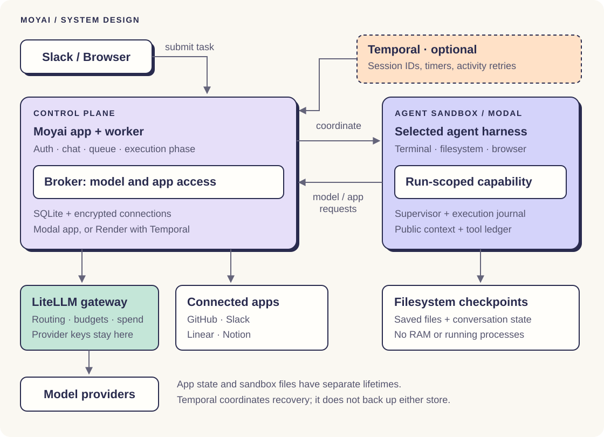
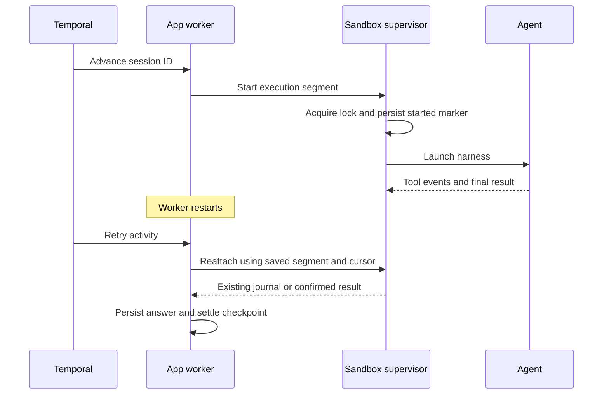

import {GuideNav} from '@site/src/components/Moyai';

<GuideNav active="architecture" />

Moyai 把对话的生命周期与执行当前任务的机器分离开来。Web 应用负责身份、消息、应用连接与执行记录；沙箱负责运行代理；模型访问与推理记账交给 LiteLLM。

本指南介绍 Modal 快速上手方案，以及 LiteLLM 团队实际使用的 Render 加 Temporal 布局。文中实现链接对应 Moyai 的 [`04ea562`](https://github.com/BerriAI/moyai/tree/04ea5627419c1cdcce1532667d95ba1956df8e30) 提交。如果要运行其他版本或其他沙箱提供商，请先查阅上游[部署指南](https://github.com/BerriAI/moyai/blob/main/docs/deployment.md)。

## 系统设计

[打开完整大图](./architecture.svg)。图中线条表示请求路径，并非不受限制的网络权限。图中展示的是 Modal 沙箱；Moyai 也支持其他[沙箱提供商](https://github.com/BerriAI/moyai/blob/main/docs/deployment.md)。

| 组件 | 作用 | 持久化状态 |
|---|---|---|
| Web 应用与中介（broker） | 验证用户身份、接收消息、执行连接策略、中介模型与应用调用 | 聊天记录、消息、连接记录、请求记账 |
| Agent 执行框架（harness） | 使用所选原生 API 运行模型/工具循环 | 各框架自有的历史与公开工作上下文 |
| 沙箱 | 为代理提供终端、文件与浏览器 | 文件保存在提供商快照中；活跃进程留在机器上 |
| LiteLLM 网关 | 路由模型请求、保管提供商密钥、执行密钥预算、记录推理成本 | 网关花费日志与模型配置 |
| Temporal（启用时） | 调度会话的下一步、定时器与活动重试 | 会话 ID 与少量生命周期值，不含提示词、文件或凭证 |

## 两种部署布局

### 默认：Modal 应用与沙箱

[安装指南](./setup.md)使用 `deploy_modal.py` 在 Modal 上托管一个 Web 容器，并为代理工作单独开沙箱。完成该指南不需要 Render 或 Temporal。

应用在本地磁盘上运行 SQLite，并把完整的数据库快照与结果归档提交到 Modal Volume。API 变更先落检查点再确认返回，后台活动大约每两秒记一次检查点。发生硬故障时，最新的后台事件可能丢失。

容器被替换后，应用会恢复最近一次提交的快照，把未完成的任务标记为中断，并且不重放它们对外部的写入。发送一条新消息即可从上次保存的工作区继续。请保持 `min_containers=1` 与 `max_containers=1`，并采用重建式部署（recreate deployment）；这种 SQLite 布局不支持多个写入者，也不支持滚动部署。重新部署会中断正在运行的任务。

来源：[Modal 部署](https://github.com/BerriAI/moyai/blob/04ea5627419c1cdcce1532667d95ba1956df8e30/deploy_modal.py)与[状态持久化](https://github.com/BerriAI/moyai/blob/04ea5627419c1cdcce1532667d95ba1956df8e30/docs/deployment.md#deploy-the-control-plane)。

### 可选：Render 应用、Temporal 编排、Modal 沙箱

Render 托管 Web 应用、中介、SQLite 数据库和一个共享的 Temporal 工作节点；Modal 托管相互独立的代理机器。Temporal 为每个会话运行一个工作流，并通过有界的活动（activity）驱动工作节点逐步推进。

工作节点应与 Web 应用放在同一个 Render 服务里，这样二者共享同一数据库与结果归档。一个工作节点可以协调多个会话，并不是每个代理各配一个工作节点容器。要扩展控制平面，前提是先有共享数据库与产物存储。

重启后的工作节点可以重新连上仍然存活的沙箱并读取其执行日志。Temporal 无法替代应用数据库，也无法找回丢失的磁盘。请备份该磁盘，并妥善保管加密密钥与会话密钥。

## 单个任务的完整流程：从消息到回答

1. **接收消息**。应用验证 Web 请求或校验 Slack 事件，找到会话并提交消息。启用 Temporal 时，会向该会话的工作流发送信号。
2. **准备执行**。工作节点加载已记录的阶段，配置或复用沙箱，并签发一个限定于本次运行的新能力凭证（capability）。所选的框架与模型决定走哪个网关 API。
3. **运行工具与推理**。框架在沙箱中执行代码；模型与连接应用的请求都经中介转发。应用会把活动与推理身份记录到发起请求的用户和消息名下。
4. **保存进度**。在受支持的安全边界处，运行时保存对话状态与文件，并保留未完成的工具记录，确保缺失的结果不会伪装成成功。
5. **落定响应**。应用先持久化最终回答，再收集产物并做最终快照。网页聊天可以在保存继续进行时先展示回答；Slack 投递与排队的后续消息则要等落定完成。

响应依次经历 `queued`、`provisioning`、`running`、`saving` 和 `idle`（显示为 **就绪**）。排队的后续消息沿用同一会话 ID，在前一个响应落定后才开始。

## 状态与检查点

| 状态 | 位置 | 恢复用途 |
|---|---|---|
| 对话与执行阶段 | 应用 SQLite 及其部署方式对应的备份 | 找到会话、排队消息、沙箱与日志游标 |
| 工作区文件 | 沙箱文件系统加提供商快照 | 在替换后的机器上恢复已保存的文件 |
| 公开工作上下文 | `/session/context.sqlite3`，随工作区快照一并保存 | 恢复摘要、最近的日志条目与未解决的工具记录 |
| 原生框架历史 | 各框架自有的已保存状态 | 仅当该适配器的兼容性、隐私与检查点门槛都允许时才复用 |
| 执行日志与结果 | 沙箱内分离监督进程（supervisor）的分段目录 | 工作节点断连后重新挂接，并从已保存的游标继续消费事件 |
| 工作流进度 | Temporal 历史 | 用于重试协调与调度等待；不包含工作区 |

### 只在安全边界做检查点

在文档记载的 Temporal/Hermes 流程中，Moyai 默认每十分钟请求一次周期性检查点。Hermes 会推进到下一轮工具之间的安全边界才落盘。正在运行的工具可能让这次检查点延后。

针对 Modal 沙箱 24 小时的上限，Moyai 会在 23 小时后请求续期。续期要求会话状态已保存、文件系统已有快照、工具结果已落定，并确认旧机器已经停止，然后才在替换机器上继续这一轮。在硬上限前到不了该边界的工具仍可能被中断。其他框架有各自的生命周期钩子；在假定检查点行为相同之前，请先查阅[框架指南](https://github.com/BerriAI/moyai/blob/main/docs/harnesses.md)。

顶层 Temporal 会话完成后，沙箱在消息队列清空后按 `SANDBOX_IDLE_SECONDS=300` 继续保温。该窗口内的后续消息会带着新签发的能力凭证复用这台机器。释放之后，就由新沙箱恢复已保存的检查点。保温的机器消耗算力，保存的快照可能产生存储费用。

文件系统快照只保留文件，不保留内存或正在运行的进程。浏览器连续性依赖单独的恢复机制，不要把文件系统快照当作浏览器的实时备份。

### 控制上下文规模，同时不丢工具状态

公开上下文存储维护一份只追加的清理日志、一份模型生成的摘要和一个原子的覆盖游标。摘要覆盖某个已知前缀；恢复上下文时，把它与最近的已索引条目合并。完整回执仍可通过有界读取获取。

另有一个待定工具账本，专门跟踪还没有确认结果的调用。摘要化不会清除这些记录。如果某个结果未知，恢复出的上下文会指示代理在重复该操作前，先查看原始记录、工作区状态与外部回执。

各框架的恢复方式不同。Codex 会带着恢复出的公开上下文新开一个临时的原生线程；Claude Agent SDK 和 OpenCode 只有通过适配器的复用门槛才能复用已完成的原生状态；Hermes 有自己的历史流程。更换模型或请求方时，可能需要一次带检查点的交接，以更新能力凭证与私有上下文范围。

来源：[上下文存储](https://github.com/BerriAI/moyai/blob/04ea5627419c1cdcce1532667d95ba1956df8e30/sandbox/context_store.py)、[上下文恢复](https://github.com/BerriAI/moyai/blob/04ea5627419c1cdcce1532667d95ba1956df8e30/sandbox/context_recovery.py)与[原生会话](https://github.com/BerriAI/moyai/blob/04ea5627419c1cdcce1532667d95ba1956df8e30/sandbox/native_session.py)。

## 工作节点恢复与工具恢复

### 重新挂接到存活的执行

监督进程在执行期间持有一把独占锁，并在启动框架之前写入持久的 `started.json` 标记，结果以原子方式写入。携带相同分段标识（segment identity）的重试会重新挂接到该监督进程，而不是再启动一个代理。

锁用于判定此刻是否有监督进程持有这次执行；标记则记录过去可能发生过一次启动。如果标记存在，却既没有活跃的持有者也没有已确认的结果，Moyai 会报告一次中断。重复启动可能重复执行一个已经改动过外部系统的工具。

来源：[监督进程启动守卫](https://github.com/BerriAI/moyai/blob/04ea5627419c1cdcce1532667d95ba1956df8e30/sandbox/durable_process.py)、[持久运行器](https://github.com/BerriAI/moyai/blob/04ea5627419c1cdcce1532667d95ba1956df8e30/app/durable_runner.py)与 [Temporal 运行时](https://github.com/BerriAI/moyai/blob/04ea5627419c1cdcce1532667d95ba1956df8e30/app/temporal_runtime.py)。

### 依据证据处理故障

| 故障情形 | Moyai 的应对 | 操作者或用户的动作 |
|---|---|---|
| Modal 快速上手中的 Web 容器被替换 | 恢复应用快照并中断未完成的工作 | 从上次保存的工作区显式发送一条后续消息 |
| Temporal 工作节点重启，沙箱仍存活 | 重新挂接到已记录的分段并读取其日志 | 在工作节点重连期间查看活动 |
| 沙箱在结果不确定的工作期间消失 | 中断，保留最后一个安全检查点 | 在要求继续之前，先检查文件与外部回执 |
| 启动标记已存在但没有活跃持有者或结果 | 停止，不再启动该分段 | 调查某次写入是否已经完成 |
| 最终回答已存在但工作区保存失败 | 保留回答并给出警告，维持上一个快照，取消排队的后续消息 | 继续之前先检查已保存的文件与警告 |
| 连接应用（connected app）的写入丢失了响应 | 保持结果不确定；缺少结果不能证明失败 | 重试之前先检查目标位置或发布回执 |
| Slack 发件箱投递结果不确定 | 不自动重试这次结果不确定的投递 | 要求再次投递前先检查该话题 |
| 执行前发生瞬时启动读取失败 | 重试读取；预执行检查通过时，Temporal 可以使用有界的启动恢复窗口 | 修正永久性的认证或配置错误 |

**Temporal 活动至少运行一次，Moyai 不承诺对外部系统恰好只产生一次副作用**。停止（Stop）会撤销本次运行的能力并请求清理，但无法撤销外部服务已经接受的写入。重试模型请求也可能再次产生一笔推理费用。

这些故障边界有可运行的示例，见上游的[持久性测试](https://github.com/BerriAI/moyai/blob/04ea5627419c1cdcce1532667d95ba1956df8e30/tests/test_durable.py)与[上下文测试](https://github.com/BerriAI/moyai/blob/04ea5627419c1cdcce1532667d95ba1956df8e30/tests/test_context_store.py)。

## 凭证与访问边界

提供商 API 密钥只保存在 LiteLLM 侧。Moyai 应用持有网关密钥和加密后的连接应用凭证。沙箱拿到的是一份限定于本次运行、用于访问中介的能力凭证；中介在转发请求前会校验本次运行与连接策略。

已启用的连接应用工具在连接策略下直接执行，没有管理员审批环节。部分操作另有额外的授权门槛，例如从已保存的聊天里编辑外部 PR。暂停或只读的连接会阻止新的写入。这些共享连接保留其授权身份的权限。Moyai 的共享工作区面向可信的团队成员，并非为相互隔离的租户设计。

默认的 Modal 沙箱使用容器隔离，可选的 VM 执行是另一项单独配置。不要以为沙箱出口有一份通用的允许清单。仓库代码与提示词可能经由你选择的模型提供商离开你的云环境。扩大访问范围之前，请先阅读[安全与范围](https://github.com/BerriAI/moyai/blob/main/docs/security-and-scope.md)。

## 成本核算 {#cost-accounting}

Moyai 以 LiteLLM 作为模型成本的唯一事实来源。它保存网关对每个被追踪请求的最终收费，并按用户、会话与模型对这些收费求和，保留小数精度，而不是根据 Token 数量估算价格。

Moyai 在推理前先预订一个请求标识，并把用量归到原始用户、消息、会话与模型名下。非流式请求记录最终响应成本，流式请求记录最终用量成本；流的初始头部并不是最终账单。

如果回执缺失，后台恢复流程可以用同一把网关密钥（需附加权限）查询 LiteLLM 的 `/spend/logs/v2`。这样无需重跑推理，也不会改变被中断任务的执行状态，就能补回记账。未知成本仍然可见。评估这套部署时，请把提供商的推理费用与托管/存储费用分开看待。

这些合计只覆盖有成本记录的被追踪 Moyai 请求。Moyai 之外的调用、返回成本中缺失的网关内部计费尝试，以及尚未解决的回执，都可能造成与网关密钥总额之间的差额。对账时请使用仪表板中的覆盖情况与逐请求金额。

参见[成本与回执恢复](https://github.com/BerriAI/moyai/blob/main/docs/costs.md)与[安装指南中的花费检查](./setup.md#track-spend)。
