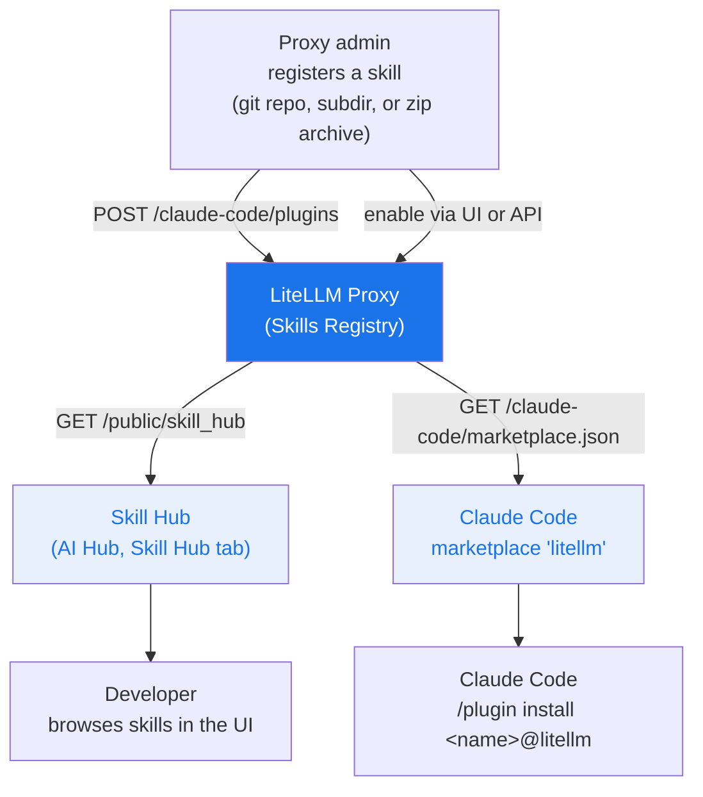

# 技能网关

<iframe width="840" height="500" src="https://www.loom.com/embed/cb74eb79df3e4c2b83a6efae54a589f9" frameBorder="0" allowFullScreen></iframe>

LiteLLM 充当**技能注册中心**（Skills Registry），是在整个组织内集中注册、管理和发现 Claude Code 技能的中心。团队只需发布一次技能，开发者和智能体就能通过同一个中心找到它，并从唯一的 Claude Code marketplace 安装。

## 工作原理



已启用的技能是公开的：任何能访问代理（proxy）的人，都能在 Skill Hub 和 `marketplace.json` 中看到它们。已停用的技能是私有的，只有获得授权的密钥或团队才能访问（参见[私有技能](#私有技能)）。新技能一经注册就会立即启用，因此想让某个技能保持私密，请将其停用。只有代理管理员（proxy admin）可以创建、更新、启用、停用或删除技能；其他任何密钥（key）都会被拒绝，收到 `401` 或 `403`。

## 快速上手

### 1. 注册技能

在管理界面（Admin UI）中打开 **Skills** 页，点击 **+ Add Skill**，然后粘贴 GitHub URL、git clone URL（HTTPS 或 SSH），或指向 zip 文件的 HTTPS 链接。LiteLLM 会自动识别来源类型并给出技能名建议，对于嵌套在子目录中的技能同样适用，例如 `github.com/org/repo/tree/main/skills/my-skill`。

也可以使用管理员密钥通过 API 注册：

```bash
curl -X POST https://your-proxy/claude-code/plugins \
  -H "Authorization: Bearer $LITELLM_MASTER_KEY" \
  -H "Content-Type: application/json" \
  -d '{
    "name": "grill-me",
    "source": {
      "source": "git-subdir",
      "url": "https://github.com/mattpocock/skills",
      "path": "skills/productivity/grill-me"
    },
    "description": "Interview skill for relentless questioning",
    "domain": "Productivity",
    "namespace": "interviews"
  }'
```

`POST` 只用于创建。如果注册的名称已存在，会返回 `409`；要修改已有技能，请改用 `PUT /claude-code/plugins/{name}`。

### 2. 发布与下架

新注册的技能默认已启用且公开。要调整哪些技能对外公开，请使用管理界面：**AI Hub → Skill Hub → Select Skills to Make Public**。

也可以走 API，用 `/disable` 下架、`/enable` 重新发布：

```bash
curl -X POST https://your-proxy/claude-code/plugins/grill-me/disable \
  -H "Authorization: Bearer $LITELLM_MASTER_KEY"
```

### 3. 浏览 Skill Hub

公开的技能会出现在管理界面的 **AI Hub → Skill Hub** 中、`/ui/model_hub` 公开页的 **Skill Hub** 标签页下（无需登录），也可以通过 API `GET /public/skill_hub` 获取。

### 4. 在 Claude Code 中安装

代理的 marketplace 只需添加一次，其名称固定为 `litellm`：

```
/plugin marketplace add https://your-proxy/claude-code/marketplace.json
```

然后通过 `<name>@litellm` 安装任意技能：

```
/plugin install grill-me@litellm
```

同样的命令也可以在 shell 中执行，即 `claude plugin marketplace add <url>` 和 `claude plugin install grill-me@litellm`。

如果想改为通过设置文件下发 marketplace，可以把它加入 `extraKnownMarketplaces`。`source` 的值必须是一个对象；扁平的 `"source": "url"` 写法会被 Claude Code 判定为无效的 marketplace 条目而忽略：

```json title="~/.claude/settings.json"
{
  "extraKnownMarketplaces": {
    "litellm": {
      "source": {
        "source": "url",
        "url": "https://your-proxy/claude-code/marketplace.json"
      }
    }
  }
}
```

## 私有技能

已停用的技能不会出现在 Skill Hub 和匿名的 `marketplace.json` 中，但你可以通过 `object_permission.skills` 把它授权给特定的密钥或团队。在管理界面中，创建或编辑密钥、团队时使用 **Allowed Skills**。通过 API 的方式：

```bash
curl -X POST https://your-proxy/key/generate \
  -H "Authorization: Bearer $LITELLM_MASTER_KEY" \
  -H "Content-Type: application/json" \
  -d '{"object_permission": {"skills": ["internal-runbook"]}}'
```

如果密钥和它所属的团队都配置了技能列表，密钥最终拿到的是两个列表的交集；否则取已配置的那一个。开发者把密钥附加到 marketplace URL 上，这样被授权的技能就会和公开技能并列显示：

```
/plugin marketplace add "https://your-proxy/claude-code/marketplace.json?key=sk-..."
```

`GET /claude-code/plugins` 和 `GET /claude-code/plugins/{name}` 适用同样的规则：非管理员密钥能看到已启用的技能，外加授权给它的那些；访问未被授权的已停用技能时会收到 `403`。代理管理员则能看到全部。

## 技能字段

| 字段 | 说明 |
|-------|-------------|
| `name` | 唯一的 kebab-case 标识符（`^[a-z0-9-]+$`），用于 `/plugin install <name>@litellm`。创建时设置，之后不可更改 |
| `source` | Claude Code 从哪里获取技能；见[来源格式](#来源格式) |
| `description` | 在中心展示的简短描述 |
| `domain` | Skill Hub 中的一级分组（如 `Engineering`、`Productivity`） |
| `namespace` | domain 内的二级分组（如 `quality`、`meetings`） |
| `category` | marketplace 中展示的分类 |
| `keywords` | 用于搜索和筛选的标签 |
| `version` | 语义化版本字符串；创建时默认为 `1.0.0` |
| `author` | `{"name": "...", "email": "..."}` |
| `homepage` | 主页 URL |

## 来源格式

| `source.source` | 必填字段 | 示例 |
|-----------------|-----------------|---------|
| `github` | `repo` | `{"source": "github", "repo": "org/repo"}` |
| `url` | `url` | `{"source": "url", "url": "https://gitlab.com/org/repo.git"}` |
| `git-subdir` | `url`、`path` | `{"source": "git-subdir", "url": "https://github.com/org/repo.git", "path": "skills/my-skill"}` |
| `archive` | `url`（HTTPS），可选 `sha256` | `{"source": "archive", "url": "https://bucket.s3.amazonaws.com/my-skill.zip", "sha256": "<64 hex chars>"}` |

`git-subdir` 的路径必须是相对路径，由字母、数字、点、连字符和下划线组成的段以斜杠分隔。`archive` 的 URL 必须使用 HTTPS；如果提供了 `sha256`，则必须是 64 个字符的十六进制摘要。Claude Code 是在开发者的机器上从这些来源下载的，因此私有仓库和归档需要在本机配置好凭据。

## API 参考

| 端点 | 鉴权 | 说明 |
|----------|------|-------------|
| `POST /claude-code/plugins` | 代理管理员 | 创建技能（名称已存在时返回 `409`） |
| `GET /claude-code/plugins` | 任意密钥 | 列出调用者可见的技能。`?enabled_only=true` 只返回公开技能 |
| `GET /claude-code/plugins/{name}` | 任意密钥 | 获取单个技能（技能已停用且未授权给调用者时返回 `403`） |
| `PUT /claude-code/plugins/{name}` | 代理管理员 | 替换一个技能。省略的字段会重置为默认值，`version` 在省略时会被清空 |
| `POST /claude-code/plugins/{name}/enable` | 代理管理员 | 发布技能 |
| `POST /claude-code/plugins/{name}/disable` | 代理管理员 | 下架技能 |
| `DELETE /claude-code/plugins/{name}` | 代理管理员 | 删除技能 |
| `GET /public/skill_hub` | 无 | 列出公开技能 |
| `GET /claude-code/marketplace.json` | 无，或 `?key=` | Claude Code marketplace 清单。`?key=` 会额外包含授权给该密钥的已停用技能 |

## Agent Skills 发现索引

通过 [`/v1/skills`](./skills.md) 并携带 `custom_llm_provider=litellm_proxy` 上传到代理自有存储的技能，还可以发布成 [Agent Skills](https://agentskills.io) 发现索引，任何支持该格式的智能体都能用 `npx skills add` 安装它们。这个存储与上文的 Claude Code marketplace 相互独立：通过 `/claude-code/plugins` 注册的插件不会出现在其中。

该索引默认关闭，因为发现客户端不会携带凭据；一旦开启，存储中的每个技能都会向所有能访问代理的人公开：

```yaml title="config.yaml"
litellm_settings:
  public_skills_index: true
```

开启后，代理会在 `GET /.well-known/agent-skills/index.json`（同时也在 `/.well-known/skills/index.json`）提供索引，并以 zip 形式在 `GET /v1/skills/{skill_id}/archive` 提供每个技能。该设置关闭时，这三个路由都会返回 `404`。从客户端安装：

```bash
npx skills add https://your-proxy -a claude-code
```
