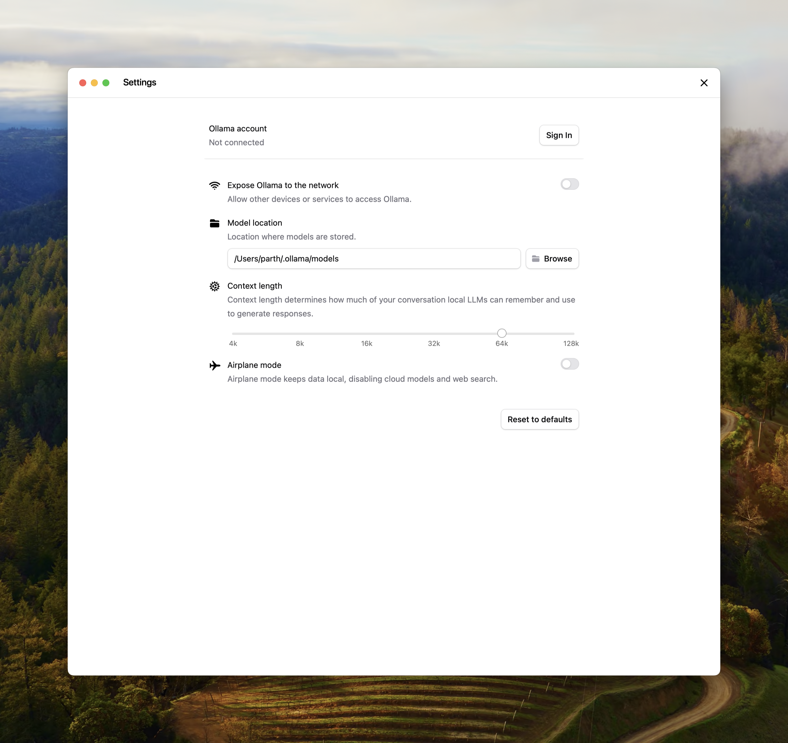

上下文长度是模型在内存中可以访问的最大 token 数。  

<Note>
  Ollama 会根据显存（VRAM）大小默认使用以下上下文长度：
    - 显存 < 24 GiB：4k 上下文
    - 显存 24-48 GiB：32k 上下文
    - 显存 &gt;= 48 GiB：256k 上下文
</Note>

网页搜索、代理和编码工具等需要大上下文的任务，应至少设置为 64000 token。

## 设置上下文长度

设置更大的上下文长度会增加运行模型所需的内存量。在调大上下文长度之前，请确保有足够的可用显存。

云端模型默认使用其最大上下文长度。

### 应用

在 Ollama 应用的设置中拖动滑块，调整到所需的上下文长度。


### CLI
如果无法在 Ollama 中直接编辑上下文长度，也可以在启动 Ollama 服务时设置。  
```
OLLAMA_CONTEXT_LENGTH=64000 ollama serve
```

### 查看已分配的上下文长度与模型卸载情况
为获得最佳性能，应为模型使用最大上下文长度，并避免将模型卸载（offload）到 CPU。可用 `ollama ps` 查看 `PROCESSOR` 列的分配情况。
```
ollama ps
```
```
NAME             ID              SIZE      PROCESSOR    CONTEXT    UNTIL
gemma4:latest    c6eb396dbd59    9.6 GB    100% GPU     131072     2 minutes from now
```
