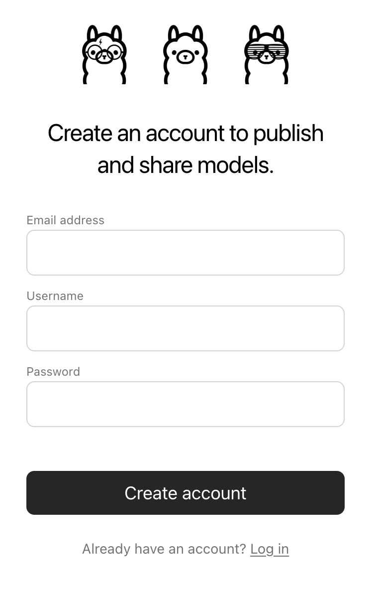
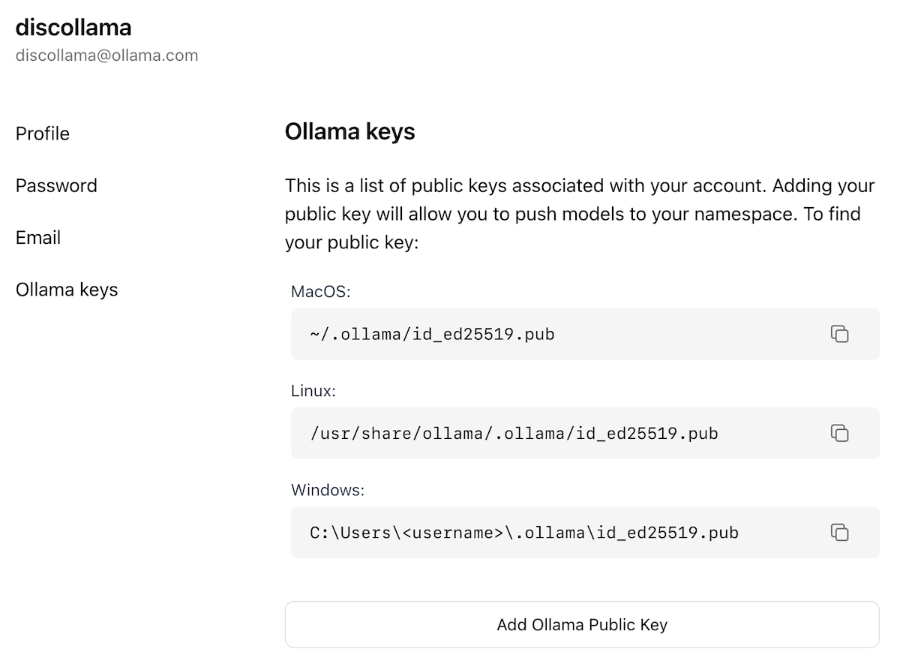

## 目录

- [导入 Safetensors 模型](#从-safetensors-权重导入模型)
- [导入 GGUF 模型](#导入-gguf-模型)
- [在 ollama.com 上分享模型](#在-ollama-com-上分享模型)

## 从 Safetensors 权重导入模型

首先，创建一个 `Modelfile`，其中的 `FROM` 命令指向存放 Safetensors 权重的目录：

```dockerfile
FROM /path/to/safetensors/directory
```

如果你把 Modelfile 创建在权重所在的同一目录下，可以直接使用命令 `FROM .`。

然后在你创建 `Modelfile` 的目录中运行 `ollama create` 命令：

```shell
ollama create my-model
```

最后，测试该模型：

```shell
ollama run my-model
```

## 导入 GGUF 模型

Ollama 在导入时不会对 GGUF 模型做量化。请先用 GGUF 工具（如 llama.cpp 的 [`llama-quantize`](https://github.com/ggml-org/llama.cpp/tree/master/tools/quantize)）准备好并完成量化。

要导入单文件 GGUF 模型，创建一个包含以下内容的 `Modelfile`：

```dockerfile
FROM /path/to/file.gguf
```

对于分片的 GGUF 模型，请保留原始的分片文件名，并使用能匹配所有分片的通配符。

```dockerfile
FROM /path/to/model-*.gguf
```

创建好 `Modelfile` 后，使用 `ollama create` 命令构建模型。

```shell
ollama create my-model
```

## 在 ollama.com 上分享模型

你可以把创建的任何模型推送到 [ollama.com](https://ollama.com) 上与其他用户分享，让他们试用。

首先，在浏览器中打开 [Ollama 注册](https://ollama.com/signup)页面。如果你已有账户，可以跳过这一步。



`Username` 字段会用作你模型名称的一部分（如 `jmorganca/mymodel`），所以请确保你选择的用户名合乎心意。

创建账户并登录后，前往 [Ollama 密钥设置](https://ollama.com/settings/keys)页面。

按照页面上的说明找到你的 Ollama 公钥位置。



点击 `Add Ollama Public Key` 按钮，将你的 Ollama 公钥内容复制并粘贴到文本框中。

要将模型推送到 [ollama.com](https://ollama.com)，首先要确保它以你的用户名正确命名。你可能需要用 `ollama cp` 命令复制
模型来给它正确的名称。对模型名称满意后，使用 `ollama push` 命令将其推送到 [ollama.com](https://ollama.com)。

```shell
ollama cp mymodel myuser/mymodel
ollama push myuser/mymodel
```

模型推送完成后，其他用户就可以用以下命令拉取并运行它：

```shell
ollama run myuser/mymodel
```
