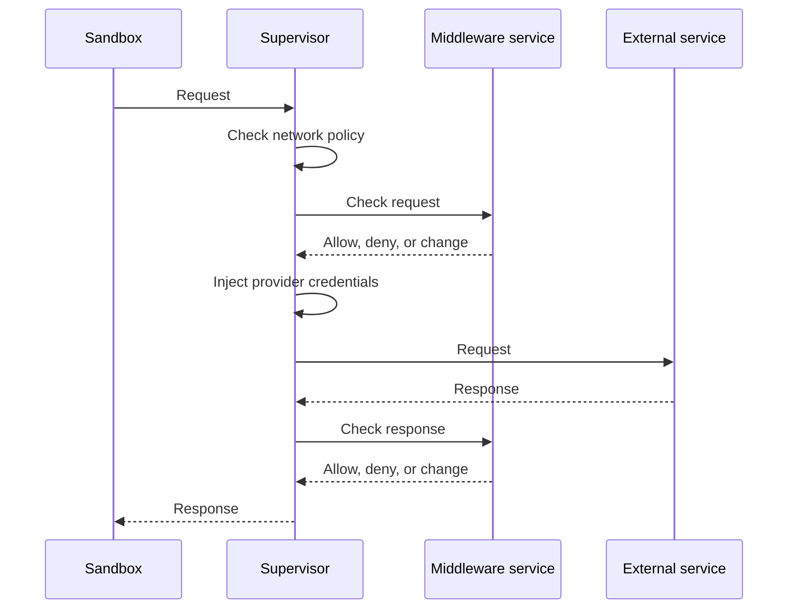

import { Aside, LinkCard, CardGrid } from '@astrojs/starlight/components';

监管中间件让你可以检查、阻止或更改智能体经网络发送与接收的内容。沙箱监管器负责强制执行沙箱的网络策略，它在智能体与外部服务之间传递流量时运行中间件。

## 何时使用中间件

网络策略决定智能体能否调用某个 API。当你还需要检查智能体发给该 API 的内容或 API 返回的内容，又不想更改智能体代码时，就使用中间件。例如，你可以：

- 从出站请求体中抹除 API 令牌。
- 拒绝包含组织禁止内容的请求。
- 在智能体收到 HTTP 响应之前移除其中的敏感内容。
- 在会话期间检查出站 WebSocket 文本消息。

[内容守卫示例](https://github.com/NVIDIA/OpenShell/tree/main/examples/supervisor-middleware-content-guard)展示了一个执行此类检查的完整中间件服务。

## 中间件如何处理流量

沙箱监管器在检查网络策略之后、把流量转发给外部服务之前调用中间件：

OpenShell 先检查网络策略，因此中间件只会看到策略放行的流量。随后它按目标主机选择中间件，并按你配置的顺序运行。OpenShell 在请求中间件运行之后才注入提供商凭据，因此中间件永远不会看到它们。

每个中间件决定放行、拒绝还是更改流量。即使网络策略放行，拒绝判定也会阻断请求。中间件出错或其服务不可用时，OpenShell 默认阻断受影响的流量。

中间件可以处理三种操作：HTTP 请求、HTTP 响应，以及智能体经 WebSocket 连接发送的文本消息。每个中间件声明自己支持哪些操作。[支持的操作](/extensibility/supervisor-middleware/operations)逐一说明。

## 当前限制

- 中间件不检查 WebSocket 二进制消息，也不检查外部服务发给智能体的消息。
- 响应中间件无法检查压缩响应、部分响应或 `Cache-Control: no-transform` 响应的正文。
- 中间件无法检查发往使用 `tls: skip` 的端点的流量。

如果你的部署要求检查这类流量，当前中间件无法满足该要求。

## 配置中间件

要把中间件加入你的沙箱，从配置开始：

<CardGrid>

<LinkCard title="配置" href="/extensibility/supervisor-middleware/configure">

挂接内置中间件，注册你自己的服务，选择失败行为，并观测中间件判定。
</LinkCard>

</CardGrid>

## 构建你的中间件服务

中间件服务是一个 gRPC 服务器，实现 [`proto/supervisor_middleware.proto`](https://github.com/NVIDIA/OpenShell/blob/main/proto/supervisor_middleware.proto) 中定义的服务。[内容守卫示例](https://github.com/NVIDIA/OpenShell/tree/main/examples/supervisor-middleware-content-guard)是一个可以直接起步的完整服务。

<Aside type="caution">

中间件 API 仍在演进。未来版本会调整它，使契约在 HTTP 请求、HTTP 响应与 WebSocket 消息之间保持一致。升级 OpenShell 时请做好更新服务的准备。[协议协商](/extensibility/overview#协议协商)会在启动时检测不兼容的版本。

</Aside>

每个中间件服务都实现以下 RPC：

- `Describe` 返回服务 manifest。manifest 列出该服务支持的操作，并为每个操作给出载荷上限与可选超时。它还携带[协议协商](/extensibility/overview#协议协商)元数据与[预期受众](/extensibility/overview#启动时确认受众)。
- `ValidateConfig` 检查策略条目中的 `config` 对象。网关在接受策略之前调用它。

随后，服务为其支持的每种操作实现一个求值 RPC，参见[支持的操作](/extensibility/supervisor-middleware/operations)。

多数 gRPC 服务器默认拒绝大于 4 MiB 的入站消息。请把服务器的上限提高到至少 4.5 MiB，使最大尺寸载荷与消息其余部分能够放下。

以下指南覆盖服务契约的其余部分：

<CardGrid>

<LinkCard title="支持的操作" href="/extensibility/supervisor-middleware/operations">

OpenShell 何时调用你的服务、会收到什么，以及针对 HTTP 请求、HTTP 响应与 WebSocket 消息能返回什么。
</LinkCard>

<LinkCard title="扩展认证" href="/extensibility/overview#扩展认证">

如何验证对你服务的调用来自你的 OpenShell 网关。
</LinkCard>

<LinkCard title="协议协商" href="/extensibility/overview#协议协商">

你的服务与 OpenShell 如何在启动时商定协议版本。
</LinkCard>

</CardGrid>
