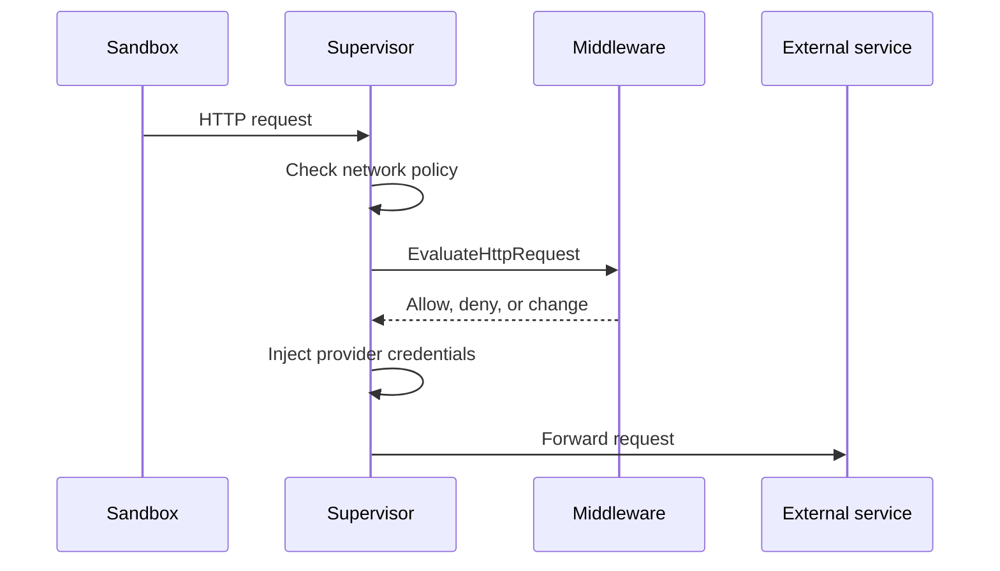
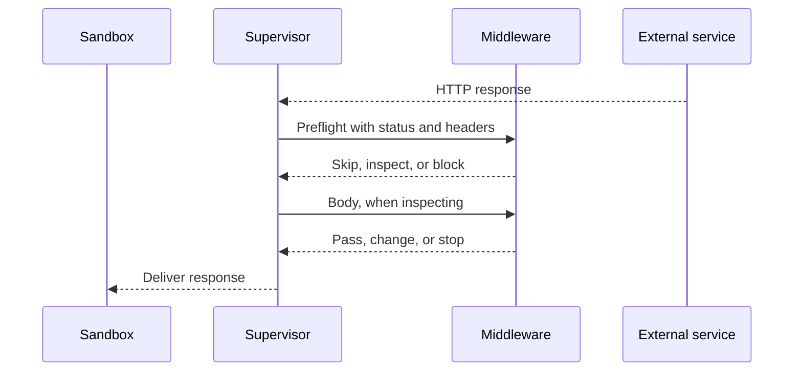
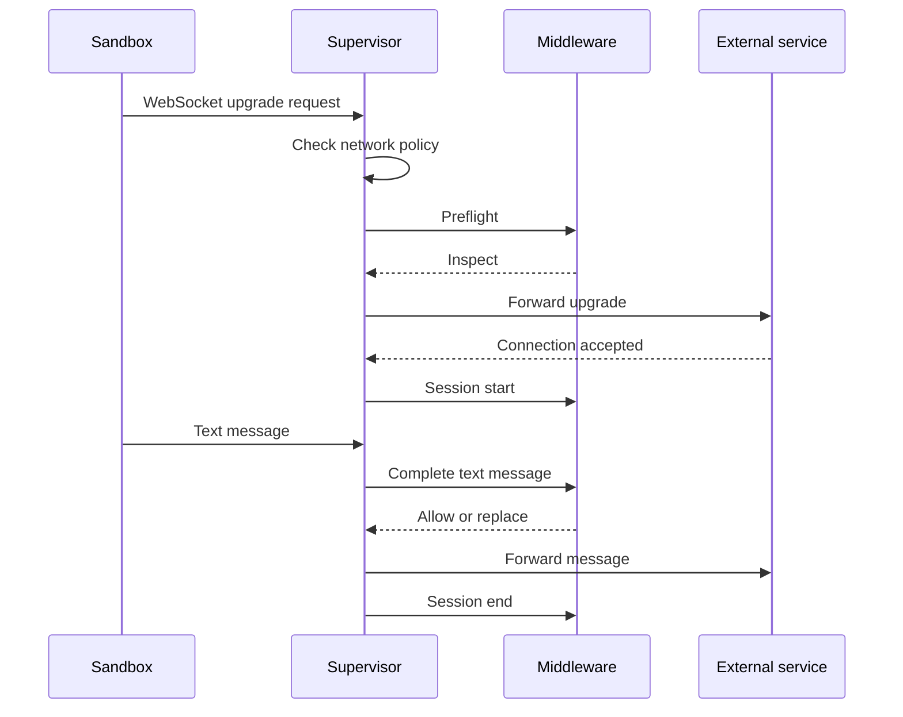

import Accordion from '@components/Accordion.astro';

中间件服务处理一种或多种操作，例如 HTTP 请求或 WebSocket 消息。本页描述 OpenShell 针对每种操作何时调用你的服务、你的服务会收到什么，以及能返回什么。每个中间件服务都要实现的 RPC 参见[构建你的中间件服务](/extensibility/supervisor-middleware#构建你的中间件服务)。

## 操作与阶段

| 操作 | 阶段 | OpenShell 何时调用你的服务 | RPC |
| --- | --- | --- | --- |
| `HTTP_REQUEST` | `PRE_CREDENTIALS` | 网络策略放行请求之后、OpenShell 注入提供商凭据之前。 | `EvaluateHttpRequest` |
| `HTTP_RESPONSE` | `PRE_RETURN` | 外部服务响应之后、沙箱收到响应之前。 | `HttpResponsePreReturn.Evaluate` |
| `WEBSOCKET_MESSAGE` | `PRE_CREDENTIALS` | 沙箱打开 WebSocket 连接时，以及它发送每条文本消息时。 | `EvaluateWebSocketSession` |

你的服务在 `Describe` manifest 中把它支持的每种操作声明为一个绑定（binding），即一个操作及其阶段。OpenShell 只为已声明的操作调用你的服务。

多个中间件匹配同一流量时，OpenShell 按 `order` 升序调用它们，每个中间件都能看到先前中间件所做的更改。

## 通用输入与结果

每种操作都带有请求上下文。上下文始终包含 `sandbox_id`。授权、持久化与关联都请使用它。可用时上下文还包含 `sandbox` 与 `workspace` 名称。名称可能被复用，因此只用于展示与日志。

包含头部的操作按线序交付头部，重复的头部保持独立。OpenShell 在把头部发给你的服务之前移除凭据、路由与逐跳头部。请求输入中还会移除成帧头部。响应预检以只读元数据形式保留上游的 `Content-Length`、`Content-Encoding` 与 `Content-Range`，除非 `Connection` 将其列为逐跳头部。你的服务不能更改或移除这些字段；下游成帧由 OpenShell 处理。

每个结果都可以附带可选的原因代码、发现与元数据：

- 原因代码说明你的服务拒绝流量的原因。OpenShell 把它写入日志与 HTTP 错误响应。长度须为 1-64 字节，以小写 ASCII 字母开头，且只能包含小写 ASCII 字母、数字与下划线。无效代码会被 OpenShell 视为中间件失败。
- 发现报告你的服务检测到的问题，即使它放行流量。OpenShell 只记录你的服务上报了多少条发现，不记录其文本。
- 元数据承载非机密的诊断细节。OpenShell 不记录它。

OpenShell 绝不会把你服务的自由文本转发给沙箱或写入日志。

## HTTP

HTTP 中间件可以在请求离开沙箱之前检查请求，在沙箱收到响应之前检查响应。服务可以支持其中一种操作，也可以两者都支持。

### 请求

OpenShell 在网络策略放行请求之后、注入提供商凭据之前调用你的服务。你的服务可以放行、拒绝或更改请求。



<Accordion title="你的服务收到什么">

请求体、目标、头部与请求上下文。

</Accordion>
<Accordion title="你的服务能返回什么">

- 原样放行请求。
- 拒绝请求，可附原因代码。
- 替换正文，不超过与输入相同的载荷上限。
- 添加、更改或移除头部。

你的服务替换正文后，OpenShell 会先按感知正文的策略（如 GraphQL、JSON-RPC 或 MCP 规则）检查新正文，再交给下一个中间件或外部服务。替换不能引入策略拒绝的操作。

</Accordion>
<Accordion title="拒绝与失败">

你的服务拒绝请求时，沙箱收到一个结构化错误，且 OpenShell 不会联系外部服务：

```json
{
  "error": "middleware_denied",
  "detail": "Request rejected by configured middleware",
  "policy": "api-policy",
  "middleware": "content-guard",
  "reason_code": "content_match"
}
```

中间件失败时，沙箱改为收到 `error: middleware_failed`。

</Accordion>
<Accordion title="头部更改规则">

结果可以包含一个有序的头部更改列表。`write` 更新通过以下取值决定如何处理同名既有头部：

- `append` 追加一个值。
- `overwrite` 替换所有既有值。
- `skip` 保留既有值。

`remove` 更新移除该名称的所有值。OpenShell 保护凭据、路由、成帧与连接头部；对响应还包括状态、认证质询、内容编码、range 与安全策略头部。头部值不能包含控制字符，请求头部值不能包含 OpenShell 凭据占位符。

OpenShell 把每个中间件的更改作为一个整体应用。任一更改无效时，全部丢弃，并把该结果视为中间件失败。

</Accordion>

### 响应

OpenShell 在外部服务响应之后、沙箱收到响应之前调用你的服务。预检时，你的服务可以跳过检查、阻断投递，或选择如何检查响应。检查期间，它可以更改或阻断响应。



<Accordion title="预检与正文模式">

预检包含状态与头部。预检结果可以跳过检查、用 `block_delivery` 阻断投递，或选择一种正文模式检查响应：

| 模式 | 行为 |
| --- | --- |
| `HEADERS_ONLY` | 检查状态与头部，不检查正文。 |
| `WHOLE_BODY_BYTES` | 在 OpenShell 向沙箱发送任何内容之前，一次性接收完整正文。 |
| `STREAM_BYTES` | 按至多 64 KiB 的有序分片接收正文，因此正文结束前就可以开始投递。 |

无正文响应、部分响应、压缩响应与带 `Cache-Control: no-transform` 的响应不支持正文检查。对这些响应，请求正文检查的中间件会失败。临时 `1xx` 响应原样通过，`101` 协议升级跳过响应中间件。

</Accordion>
<Accordion title="你的服务能返回什么">

- 原样放行响应或正文分片。
- 替换正文或正文分片。
- 添加、更改或移除头部，规则与请求相同。
- 阻断投递，可附原因代码。

</Accordion>
<Accordion title="阻断与失败">

在 OpenShell 开始发送响应之前你的服务阻断响应时，沙箱收到 `403 Forbidden`，携带与被拒请求相同的 `middleware_denied` 错误。在此之前中间件失败时，沙箱收到 `502 Bad Gateway` 与 `error: response_delivery_failed`。投递已经开始时，两种情况下 OpenShell 都会中止响应。

外部服务已经处理了请求，因此阻断其响应并不能撤销处理，重试请求可能重复副作用。

</Accordion>
<Accordion title="Trailers 与成帧">

检查正文的服务还会在正文之后收到 trailers。预检可以声明新的 trailer 名称，服务随后即可添加它们。

中间件更改正文后，OpenShell 重新计算 `Content-Length` 与成帧，因此你的服务无需处理传输编码。

</Accordion>

## WebSocket

WebSocket 中间件检查沙箱经 WebSocket 连接发送的文本消息。

### 消息

沙箱打开 WebSocket 连接时，以及之后每发送一条文本消息，OpenShell 都会调用你的服务。你的服务可以放行、拒绝或替换每条消息。



<Accordion title="会话事件">

OpenShell 为每个连接向你的服务打开一个双向流，并发送以下事件：

1. 联系外部服务之前的预检。你的服务返回 `INSPECT`、`SKIP` 或 `DENY`。`SKIP` 关闭中间件流，所有消息都不经该中间件检查而直接通过。`DENY` 拒绝升级。
2. 外部服务接受连接后的会话开始。它包含协商出的子协议。
3. 来自沙箱的每条完整文本消息，按顺序。
4. 连接关闭时的会话结束，尽力送达。

你的服务为每个预检与每条消息返回一个结果。会话开始与结束是通知，无需返回结果。OpenShell 关闭它那一侧的流时，请一并结束你这一侧的流。

</Accordion>
<Accordion title="消息处理">

OpenShell 在发送之前重组分片消息并解压 `permessage-deflate` 消息，因此你的服务始终收到完整的 UTF-8 文本消息。替换内容可以是任意文本，包括空字符串。OpenShell 会在转发之前重新成帧，并在需要时重新压缩替换内容。

OpenShell 不会把二进制消息、控制帧或来自外部服务的消息发给中间件。二进制消息原样通过，OpenShell 记录 `unsupported_message_type` 覆盖事件。消息序号同样计入二进制消息，因此你的服务可以看到文本消息之间的空缺。

只有声明了 `WEBSOCKET_MESSAGE` 的中间件才会收到消息。只声明 `HTTP_REQUEST` 的中间件仍会检查升级请求，OpenShell 会为它记录 `binding_not_selected` 覆盖事件。

</Accordion>
<Accordion title="拒绝与失败">

被拒的消息以代码 `1008` 关闭连接。中间件失败时，OpenShell 拒绝升级或关闭连接。使用 `fail_open` 时，OpenShell 改为在连接的剩余时间内停用该中间件。

</Accordion>
<Accordion title="关闭代码">

| 代码 | 含义 |
| --- | --- |
| `1002` | WebSocket 协议错误。 |
| `1007` | 无效 UTF-8 文本。 |
| `1008` | 中间件或策略拒绝。 |
| `1009` | 文本消息超过 4 MiB 平台上限。 |
| `1012` | 策略变更要求重启连接。 |
| `1013` | 消息组装容量已满。 |

</Accordion>

## 限制

| 限制 | 适用范围 | 值 |
| --- | --- | --- |
| 每个中间件的载荷 | 所有操作 | 注册的 `max_payload_bytes`，至多 4 MiB。适用于请求体、完整响应体或单个流式分片、一条文本消息，以及每个替换内容。 |
| 每次求值或流式交换的时限 | 所有操作 | 注册 `timeout` 与服务 manifest 中绑定超时二者中的较小值。被接受的 HTTP 响应与 WebSocket 流没有连接级期限。 |
| 流式正文分片 | HTTP 响应 | 64 KiB。 |
| 所有中间件处理单个流式分片的总时限 | HTTP 响应 | 30 秒。 |
| 每条消息的分片数 | WebSocket 消息 | 4,096。 |
| 组装一条消息的时限 | WebSocket 消息 | 无进展 30 秒，或总计 2 分钟。 |
| 转发一条消息的时限 | WebSocket 消息 | 2 分钟。 |

载荷超过某个中间件的上限时，该中间件失败。其他中间件仍按各自的上限执行。

每个沙箱的中间件求值容量由所有操作共享。容量占满时，OpenShell 对 HTTP 请求在读取正文之前返回 `503 Service Unavailable`。WebSocket 消息组装容量占满时，OpenShell 以代码 `1013` 关闭连接。
