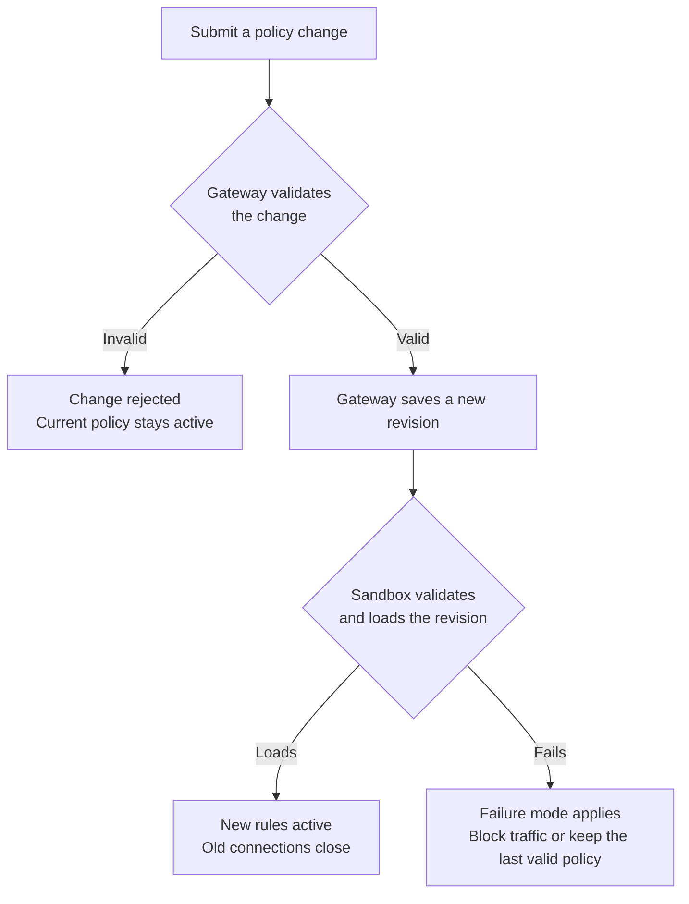

import { Aside, Tabs, TabItem } from '@astrojs/starlight/components';

本页介绍如何用 OpenShell CLI 管理沙箱策略：从创建沙箱时设置策略，到沙箱运行期间修改策略、确认变更生效以及回滚。运行 `openshell policy --help` 查看全部命令与选项。

## 创建带策略的沙箱

创建沙箱时传入策略文件。文件系统、Landlock 与进程设置只在沙箱启动时生效，因此在这里设置：

```shell
openshell sandbox create --name my-sandbox --policy ./policy.yaml
```

本页其余部分把这个沙箱称为 `my-sandbox`。`openshell policy` 命令省略沙箱名时，CLI 使用你最近创建、连接或执行过命令的沙箱，并打印其名字。

要对创建的每个沙箱使用同一份文件，设置 `OPENSHELL_SANDBOX_POLICY` 而不传 `--policy`：

```shell
export OPENSHELL_SANDBOX_POLICY="$PWD/policy.yaml"
openshell sandbox create --name my-sandbox
```

两者都没有时，沙箱使用镜像内的策略或严格受限的[默认策略](/how-it-works/policies/default-policy)。

## 在镜像中内置策略

要把策略放进沙箱镜像，把它添加到 `/etc/openshell/policy.yaml`：

```dockerfile
COPY policy.yaml /etc/openshell/policy.yaml
```

只有沙箱没有已保存策略时 OpenShell 才使用镜像策略，因此 `--policy` 文件或 `OPENSHELL_SANDBOX_POLICY` 优先。镜像策略无效时，沙箱不会启动，直到你[用有效策略替换它](#新沙箱停留在-provisioning)。OpenShell 不会回退到默认策略。

## 检查当前策略

沙箱策略有两个视图。基础策略是你为沙箱设置的策略。生效策略是基础策略加上挂接提供商添加的规则，最新修订加载后沙箱强制执行生效策略。全局策略活动时，两个视图都显示全局策略。`--base` 显示基础策略，`--full` 显示生效策略：

```shell
openshell policy get my-sandbox --base
openshell policy get my-sandbox --full
```

编辑请从基础策略入手，因为提供商规则属于其提供商，不属于沙箱自己的策略。用生效策略查看沙箱可访问的一切，例如查明某个请求为何被放行。

把生效策略保存为 YAML 文件，例如用于审阅或用[策略证明器](/how-it-works/policies/prover)检查：

```shell
openshell sandbox get my-sandbox --policy-only > effective-policy.yaml
```

查看策略的每个修订及沙箱是否已加载：

```shell
openshell policy list my-sandbox
```

## 添加或移除网络访问

`openshell policy update` 在运行中的沙箱上添加或移除网络规则。它只修改 `network_policies` 小节，因此不需要完整的策略文件。

例如，让沙箱中的 `curl` 对 GitHub API 发起只读请求：

```shell
openshell policy update my-sandbox \
  --rule-name github_readonly \
  --binary /usr/bin/curl \
  --add-endpoint api.github.com:443:read-only:rest:enforce \
  --wait
```

端点取值列出主机、端口、访问预设、协议与强制模式。`read-only` 允许 `GET`、`HEAD` 与 `OPTIONS` 请求，`rest` 开启 HTTP 请求检查，`enforce` 阻断其余所有请求。`--binary` 取值必须是沙箱内可执行文件的真实路径，参见[二进制匹配](/how-it-works/policies/network-rules#二进制匹配)。

要在既有规则上允许另一种请求，添加一条允许规则。用 `--rule-name` 指名规则，用 `--binary` 列出规则中的每个二进制。列表与规则的二进制不匹配时命令会失败，因此新权限无法触及你没有指名的二进制：

```shell
openshell policy update my-sandbox \
  --rule-name github_readonly \
  --binary /usr/bin/curl \
  --add-allow 'api.github.com:443:POST:/repos/*/*/issues' \
  --wait
```

由于该端点使用 `read-only` 预设，OpenShell 先把预设替换为等价的显式规则，再添加你的规则。`--rule-name` 指的是 `network_policies` 下的规则键，可能与规则的 `name` 字段不同。以同样方式使用 `--add-deny` 阻断请求。移除规则：

```shell
openshell policy update my-sandbox --remove-rule github_readonly --wait
```

要预览变更而不应用，把 `--wait` 换成 `--dry-run`。预览不保证沙箱会接受该变更。`--remove-endpoint` 从基础策略中列出该目的地的每条规则里移除该目的地，并删除不再有端点的规则。提供商添加的规则保留该目的地。

## 整体替换策略

`openshell policy set` 替换整个策略。`policy update` 无法完成的变更用它，例如中间件、GraphQL、MCP 或 JSON-RPC 规则、`tls: skip`、凭据绑定或请求签名。新文件替换每个小节，因此请从当前基础策略入手。

<Tabs>
<TabItem label="编辑 YAML">
打印基础策略：

```shell
openshell policy get my-sandbox --base
```

命令先打印修订详情，再打印策略。只把策略 YAML 保存为 `policy.yaml`，然后编辑要变更的小节。其余内容全部保留，包括沙箱启动时 OpenShell 添加的文件系统路径。

提交编辑后的文件并等待结果：

```shell
openshell policy set my-sandbox --policy policy.yaml --wait
```

</TabItem>
<TabItem label="用 jq 脚本化">
把基础策略保存为 JSON：

```shell
set -o pipefail
openshell policy get my-sandbox --base --output json \
  | jq -e '.policy' > base-policy.json
```

编辑 `base-policy.json`，然后提交并等待结果：

```shell
openshell policy set my-sandbox --policy base-policy.json --wait
```

</TabItem>
</Tabs>

下一节描述新策略的各部分如何生效。

## 变更如何生效

用 `openshell policy update` 或 `openshell policy set` 应用变更时，策略的网络小节在运行中的沙箱生效。启动小节不会：

| 变更 | 对运行中沙箱的影响 | 所需操作 |
|---|---|---|
| 网络规则 | 沙箱加载新规则。先前规则下打开的连接关闭。 | 应用变更，然后重试请求。 |
| `network_middlewares` 中的中间件 | 可以添加、移除或重新配置内置中间件与已向网关注册的外部服务。 | 用 `openshell policy set` 应用变更。 |
| 外部中间件注册 | 策略变更无法注册服务或更改其网关连接设置。 | 更新网关配置并重启网关。 |
| 新增文件系统路径 | 已保存的策略可以变更，但运行中的工作负载保留既有的文件系统权限。 | 重建沙箱。 |
| 移除文件系统路径，或更改 `include_workdir`、Landlock 或进程设置 | 工作负载启动后 OpenShell 拒绝该变更。 | 重建沙箱。 |

新网络规则生效时，OpenShell 关闭在先前规则下打开的连接，包括 HTTP keep-alive 连接、隧道、WebSocket 连接与长连接流。客户端必须重新连接，其后续请求按新规则检查。

每个变更生效之前 OpenShell 校验两次：



沙箱再次校验修订，因为它还要考虑提供商规则与同时到达的其他变更。沙箱无法加载修订时，由[网关配置](/how-it-works/gateways/configuration#完整示例)中的 `policy_validation_failure_mode` 选项决定后续行为。默认的 `fail_closed` 让沙箱阻断网络流量，直到你提交有效策略；`retain_last_valid` 则保持最后一个有效策略活动。[变更加载失败](#变更加载失败)说明如何修复被拒绝的变更。

## 修改文件系统与进程设置

文件系统、Landlock 与进程设置只在沙箱启动时生效，因此修改它们需要新沙箱。按[整体替换策略](#整体替换策略)所述保存基础策略，并在文件中编辑这些设置。

策略允许网络访问时，OpenShell 会添加沙箱进程需要的系统路径，因此只列出工作负载需要的路径即可。[基线文件系统路径](/how-it-works/policies/default-policy#基线文件系统路径)列出了这些路径。

<Aside type="caution">
删除沙箱会停止其进程并移除其状态。删除之前请复制出需要的内容。
</Aside>

删除沙箱并用编辑后的文件创建新沙箱：

```shell
openshell sandbox delete my-sandbox
openshell sandbox create --name my-sandbox --policy ./policy.yaml
```

删除命令报告清理待完成时，等到 `openshell sandbox get my-sandbox` 找不到该沙箱后再创建新沙箱。

## 验证变更

不带 `--wait` 时，命令成功只表示网关接受了变更。带 `--wait` 时，CLI 还会等待沙箱报告结果。沙箱拒绝修订时以状态 `1` 退出，等待超时以状态 `124` 退出。等待超时的变更之后仍可能加载成功，因此重新提交前先检查修订状态。

退出成功不一定表示变更已生效。也可能是策略本来就没有变化，或更新的变更在你的变更加载之前替换了它。确认结果：

```shell
openshell policy list my-sandbox
openshell policy get my-sandbox --full
```

最新修订应显示 `Loaded`，生效策略应包含你的变更。

然后各测试一条应放行与应阻断的请求。确认拒绝来自 OpenShell（`policy_denied` 响应或沙箱日志条目），而不是来自目的地服务或客户端工具缺失。

## 回滚到更早的修订

要恢复更早的策略，在 `openshell policy list my-sandbox` 中找到修订并打印其基础策略。例如修订 2：

```shell
openshell policy get my-sandbox --rev 2 --base
```

把输出中的策略 YAML 保存为 `previous-base.yaml`，审阅后作为新修订提交：

```shell
openshell policy set my-sandbox --policy previous-base.yaml --wait
```

回滚只恢复策略。它不恢复提供商配置档案、挂接、凭据或全局策略，文件系统与进程变更的限制仍然适用。

## 应用全局策略

网关管理员可以对网关上的每个沙箱施加同一条策略。全局策略替换每个沙箱的策略并阻止沙箱策略变更，直到你删除它。这些命令要求平台管理员角色：

| 任务 | 命令 |
|---|---|
| 查看当前全局策略。 | `openshell policy get --global --full` |
| 应用经审阅的完整策略。 | `openshell policy set --global --policy ./global-policy.yaml` |
| 查看全局策略历史。 | `openshell policy list --global` |
| 移除全局策略并恢复正常策略选择。 | `openshell policy delete --global` |

set 与 delete 命令会请求确认，因为每条命令都改变网关上每个沙箱的网络访问。运行中的沙箱在下一次配置检查时（约 10 秒内）加载新全局策略。全局策略不支持 `--wait`，请在沙箱中测试流量以确认变更。删除全局策略后，`policy get --global` 仍显示最后一条，状态为 `Superseded`。删除全局策略时，如果某个沙箱自己的策略与提供商规则恢复后无效，删除会失败。

## 故障排查

### 请求被拒绝

OpenShell 记录每条被拒连接的目的地、二进制与原因，以及每条被拒请求的方法、路径与原因。先查看沙箱日志：

```shell
openshell logs my-sandbox --since 10m --source sandbox
```

不要用 `--level warn` 过滤该日志，它会隐藏策略事件。把日志中的二进制与目的地和生效策略对比，并用响应中的错误码定位原因：

| 错误 | 原因 | 检查什么 |
|---|---|---|
| `policy_denied` | 没有规则允许该连接，或请求规则阻断了请求。 | 某条规则列出了日志中的二进制、主机与端口，且其请求规则允许该方法与路径。脚本以其解释器出现，例如 `/usr/bin/python3.12`。 |
| `request_authority_mismatch` | HTTP 请求的主机或端口与连接的目的地不同。 | 客户端的 `Host` 头部（包括任何非默认端口）与连接匹配。 |
| `credential_endpoint_mismatch` | 网络规则放行了请求，但提供商凭据未绑定该目的地。 | 提供商的配置档案端点或凭据绑定。不要放宽网络规则。 |
| `credential_placeholder_in_request_body` | 请求体包含无效或已吊销的凭据占位符。 | 移除失效占位符或恢复提供商。 |
| `unsupported_l7_protocol` | 请求使用了端点无法检查的协议或升级，例如 h2c，或发送到 GraphQL、MCP 或 JSON-RPC 端点的 `Upgrade` 头部。任何规则都无法允许它。 | 不带升级发送请求，或通过单独的 `protocol: websocket` 端点放行 WebSocket 流量。 |

### 变更加载失败

`openshell policy list my-sandbox` 显示沙箱拒绝为 `Failed` 的修订及截短的错误。运行 `openshell policy get my-sandbox --rev <N>` 查看完整错误。网络访问的后续行为取决于[变更如何生效](#变更如何生效)描述的失败模式。默认的 `fail_closed` 让沙箱在有效策略加载之前阻断网络流量。修复错误并重新提交策略，或[回滚到更早的修订](#回滚到更早的修订)。

### 新沙箱停留在 Provisioning

`openshell sandbox create` 会拒绝无效的策略文件。新沙箱启动时配置失败（例如镜像策略无效或提供商冲突）时，沙箱停留在 `Provisioning`，工作负载不启动。其 `ConfigurationReady` 条件显示原因 `ConfigurationInvalid`。检查诊断信息；镜像策略无效时，查看沙箱日志了解具体错误：

```shell
openshell sandbox get my-sandbox --output json
```

网关以 `FAILED_PRECONDITION` 或 `INVALID_ARGUMENT` 拒绝镜像策略上传或添加基线文件系统路径的策略更新时，适用同样的修复窗口。网关确认拒绝报告之后，启动流程等待两秒，读取新配置并重试。你的修复先于该报告到达网关时，启动流程立即读取修复后的配置。沙箱日志记录网关的理由；同一写入、状态码与配置的重复拒绝只记录一次。认证与授权失败仍会停止启动。

监管器开始准入后，你有 300 秒时间修复配置。镜像准备有各自的截止时间，不占用该修复时间。用 `openshell policy set` 替换策略，或修复提供商配置。工作负载首次启动之前，你还可以更改文件系统、Landlock 与进程设置。对策略、提供商或设置每次生效的变更都会重新计时 300 秒；写入不变的值不会。

时间用尽时，沙箱转入 `Error`，原因为 `ProvisioningTimedOut`。修复配置不会重启它。修复后重新启动沙箱。准备完成之后，准入获得新的 300 秒窗口：

```shell
openshell sandbox start my-sandbox
```

## 后续步骤

- 可改用于常见服务与协议的示例规则参见[网络规则](/how-it-works/policies/network-rules)。
- 用[策略证明器](/how-it-works/policies/prover)检查策略授予的访问不超过你定义的边界。
- 用[策略顾问](/how-it-works/policies/advisor)让智能体提议所需网络规则供你审阅。
- 所有字段、默认值与约束参见[策略 Schema 参考](/how-it-works/policies/schema)。
